# Chapitre II : Le traitement d'images, l'art du filtrage et de la transformation

Ce chapitre abordera les fondamentaux du traitement d'images numériques.
Il introduira entre autres les filtres et transformées qui sont à la base des outils "d'apprentissage profond" (ou "Deep Learning" en anglais) utilisés en "vision par ordinateur".

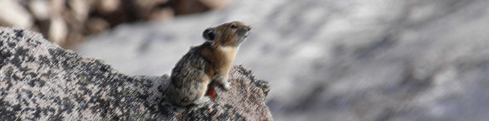

_"Vibre la lumière, Chantez les couleurs, Il y met sa vie, Le bruit de son coeur._

_Et comme un bateau, Porté par sa voile, Doucement le pinceau, Glisse sur la toile._

_Et voilà l'homme, Qui croise avec ses yeux, Le temps d'un éclair, Le regard des dieux._

_Cézanne peint, Il laisse s'accomplir le prodige de ses mains._

_Cézanne peint, Et il éclaire le monde pour nos yeux qui n'voient rien."_

**Michel Berger & France Gall, Cézanne peint, 1985**

---

## Images exemples

Ce chapitre sera illustré par une image exemple.

Vous la trouverez [ici](https://github.com/NicOudart/UVSQ_EN3901_computer_vision/blob/master/images/Prairie_dog.jpg).

Il s'agit d'une photographie d'un _Cynomys ludovicianus_, aussi connu sous le nom de "Black-tailed Prairie Dog", prise en 2022 à Boulder (Colorado, USA).

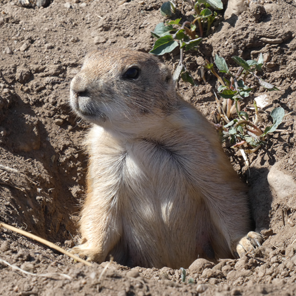

N'hésitez pas à aller regarder les détails de la prise de vue de cette photographie dans les métadonnées !

## Le traitement d'image

## Transformations géométriques

### Agrandissement / rétrécissement

### Rotation / translation

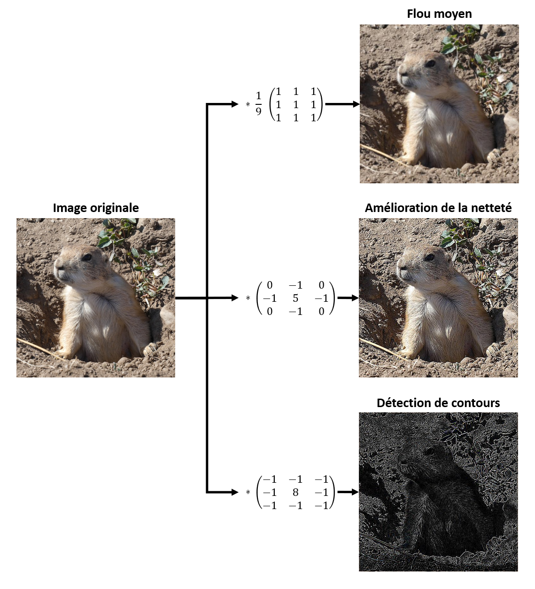

## Filtrage linéaire

### Convolution

### Choix du kernel

## FFT et filtrage fréquentiel

### Analyse spectrale d'une image

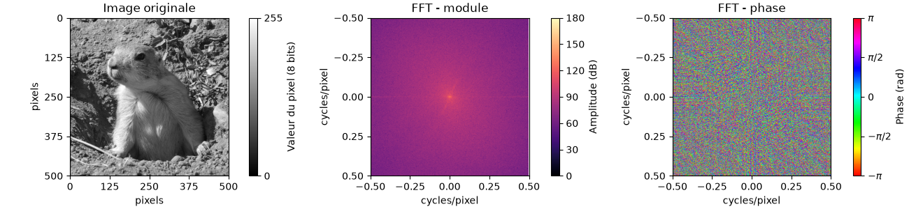

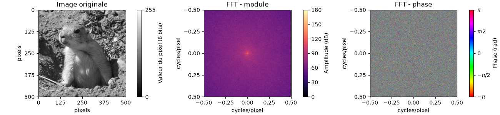

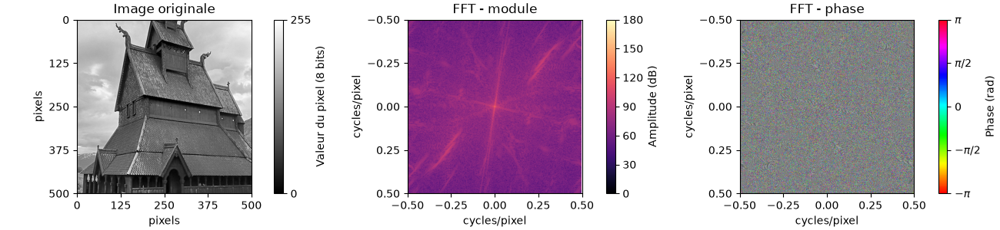

### Filtrage en fréquences d'une image

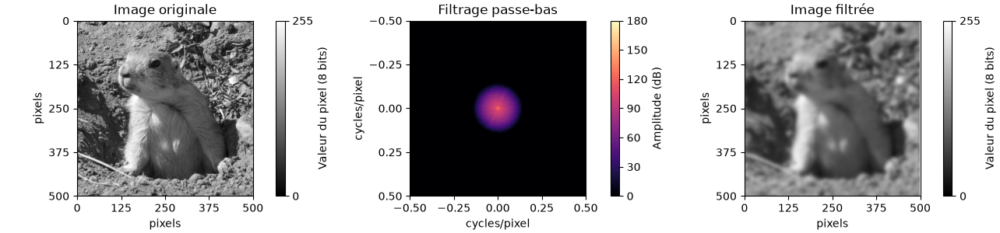

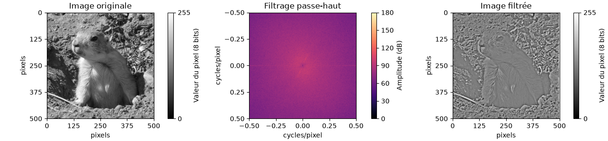

## Opérations morphologiques

### Element structurant

### Filtre médian

### Erosion et dilatation

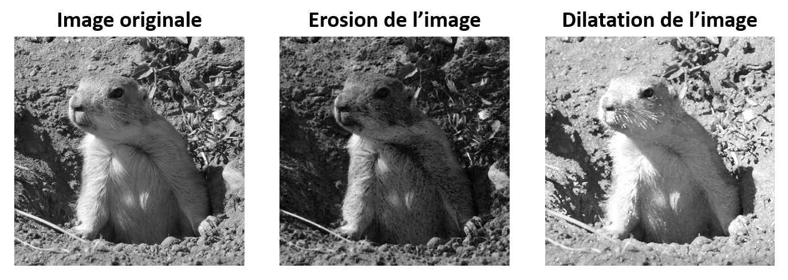

### Ouverture et fermeture

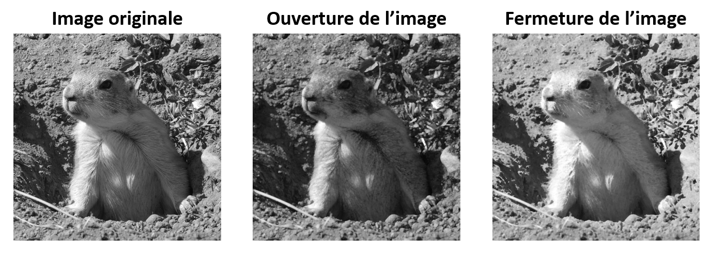

## Détection de contours ou de coins

### Filtre de Sobel

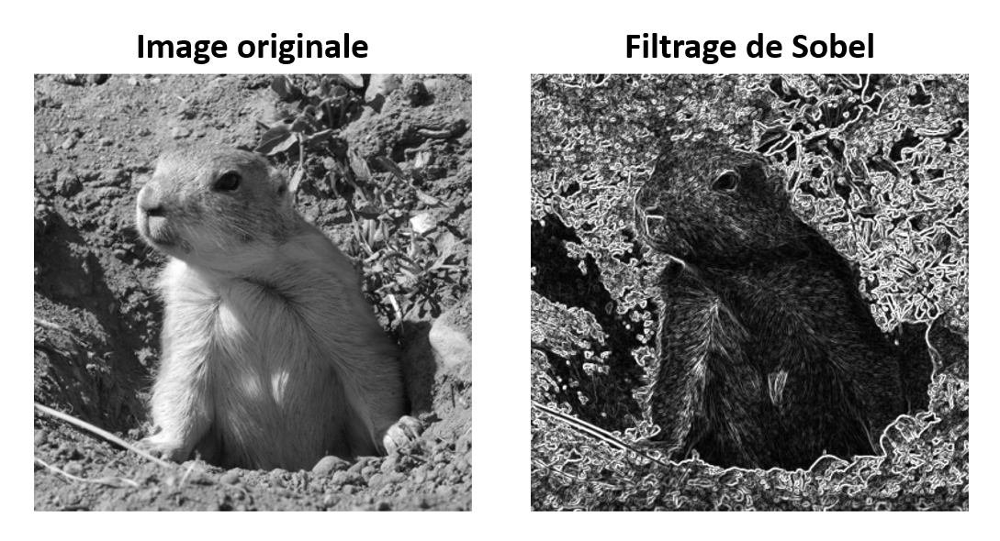

### Filtre de Canny

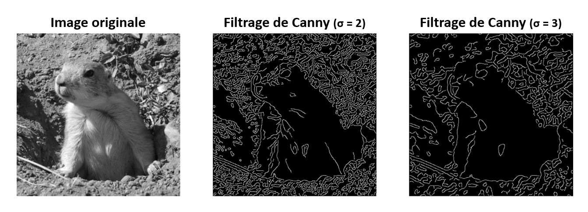

### Filtre de Harris

## Détection de forme

### La transformée de Hough

### Adaptation aux cercles

### Généralisation