# Chapitre II : Le traitement d'images, l'art du filtrage et de la transformation

Ce chapitre abordera les fondamentaux du traitement d'images numériques.
Il introduira entre autres les filtres et transformées qui sont à la base des outils "d'apprentissage profond" (ou "Deep Learning" en anglais) utilisés en "vision par ordinateur".

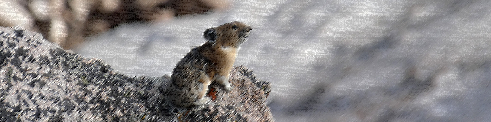

_"Vibre la lumière, Chantez les couleurs, Il y met sa vie, Le bruit de son coeur._

_Et comme un bateau, Porté par sa voile, Doucement le pinceau, Glisse sur la toile._

_Et voilà l'homme, Qui croise avec ses yeux, Le temps d'un éclair, Le regard des dieux._

_Cézanne peint, Il laisse s'accomplir le prodige de ses mains._

_Cézanne peint, Et il éclaire le monde pour nos yeux qui n'voient rien."_

**Michel Berger & France Gall, Cézanne peint, 1985**

---

## Images exemples

Ce chapitre sera illustré par quelques images exemples.

Vous trouverez la première [ici](https://github.com/NicOudart/UVSQ_EN3901_computer_vision/blob/master/images/Prairie_dog.jpg).

Il s'agit d'une photographie d'un _Cynomys ludovicianus_, aussi connu sous le nom de "Black-tailed Prairie Dog", prise en 2022 à Boulder (Colorado, USA).

Par défaut, nous utiliserons cette image pour illustrer les différentes méthodes de traitement d'images.

Dans les cas spécifiques où nous avons besoin d'une image contenant des contours ou des coins bien définis, nous utiliserons une seconde image que vous trouverez [ici](https://github.com/NicOudart/UVSQ_EN3901_computer_vision/blob/master/images/Vizcacha.jpg).

Il s'agit d'une photographie d'une mosaïque représentant une _Lagidium peruanum_, aussi connue sous le nom de "Vizcacha del Norte", prise en 2025 à Huancayo (Pérou).

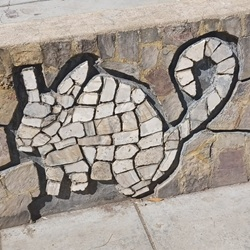

Et dans les cas spécifiques où nous avons besoin d'une image avec des lignes ou des cercles à détecter, nous utiliserons une troisième image que vous trouverez [ici](https://github.com/NicOudart/UVSQ_EN3901_computer_vision/blob/master/images/Pika.jpg).

Il s'agit d'une photographie d'un _Ochotona princeps_, aussi connu sous le nom d' "American Pika", prise en 2022 au Rocky Mountain National Park (Colorado, USA).

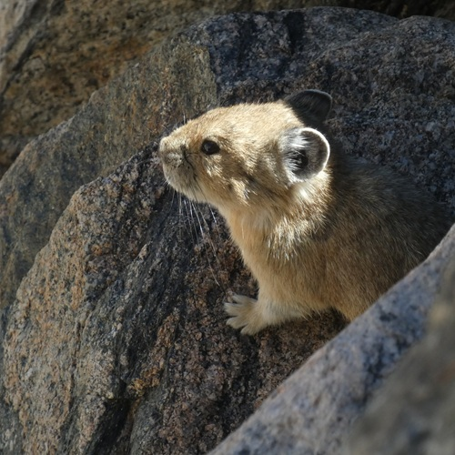

N'hésitez pas à aller regarder les détails de la prise de vue des différentes photographies dans les métadonnées des images !

## Le traitement d'image

Lors du chapitre précédent, nous avons introduit le concept de "vision". 
Puis, nous avons parlé des problématiques liées à l'acquisition d'image avec une caméra.
Ensuite, nous avons parlé des problématiques liées à l'enregistrement d'images sous forme numérique.
Et enfin, nous avons introduit les concepts de "retouche" et "d'étalonnage" d'images.

La suite logique dans n'importe quel projet de vision par ordinateur est le **traitement d'image**.
Il s'agit de l'ensemble des **méthodes mathématiques** et **algorithmiques** "classiques" (hors IA) appliquables à des **images numériques** afin de les adapter à une méthode d'analyse, en faisant **ressortir des informations pertinentes**.

L'idée est qu'une image peut être considérée comme un signal discret 2D, et par conséquent on peut lui appliquer :

* Des manipulations **géométriques**, permettant d'adapter l'image selon un besoin spécifique en termes de dimensions, d'orientation, ou de translation spatiale.

* Des **filtres**, qui viennent modifier les valeurs des pixels de l'image pour faire **ressortir certaines propriétes spatiales** de l'image (les petits ou les gros élements, les contours, les coins, etc.).

* Des **transformations**, qui donnent accès à des **espaces de représentation différents** pour un image, permettant ainsi d'en tirer des **caractéristiques spatiales quantitatives** (fréquences horizontales ou verticales, lignes, cercles, etc.).

Ce chapitre vous présentera les outils de base en traitement d'image.
Il ne s'agira pas ici d'être exhaustif.
Nous nous attarderons en particulier sur les méthodes qui sont à l'origine de l'analyse d'images par IA, qui sera le sujet des 2 derniers chapitres de ce cours.

## Manipulations géométriques

Certaines applications de vision par ordinateur nécessitent d'adapter la dimension d'une image, de déplacer un objet sur une image, ou de changer son orientation.
Nous allons voir comment réaliser ces manipulations géométriques de base, et ce qu'elles impliquent en termes de reconstitution du signal contenu dans l'image.

### Agrandissement / réduction

Comme mentionné plus tôt, on peut considérer une image numérique comme un **signal 2D discret**.
Par conséquent, modifier les dimensions d'une image numérique revient à **rééchantillonner** ce signal.

C'est ce que l'on appelle du "**redimensionnement d'image**".
Lorsque l'on cherche à augmenter les dimensions d'une image (et donc son nombre d'échantillons), on parle d'un "**agrandissement**".
Lorsque l'on cherche à diminuer les dimensions d'une image (et donc son nombre d'échantillons), on parle d'une "**réduction**".

La grande problématique du redimensionnement d'image est de respecter le **théorème de Nyquist-Shannon** vu au chapitre précédent : pour représenter discrètement un signal n'ayant pas de composantes fréquentielles supérieures à $f_{max}$, il faut choisir une fréquence d'échantillonnage $f_s$ telle que $f_s > 2 f_{max}$.

Une image étant un signal 2D discret, il faut donc que la fréquence d'échantillonnage respecte ce critère vis-à-vis de la plus grand fréquence spatiale contenue dans l'image, **selon les axes horizontaux et verticaux**.
Pour rappel, si ce critère n'est pas respecté lors du redimensionnement, l'image redimensionnée risque de souffrir d'un phénomène appelé **aliasing**, qui sera visible sous la forme d'artefacts appelé "Moiré".

**Agrandir** une image revient à **augmenter sa fréquence d'échantillonnage** horizontale et verticale.
Il n'y a donc **aucun de risque d'enfreindre le critère de Nyquist-Shannon**.

Pour agrandir une image on va donc simplement appliquer l'algorithme suivant :

|Agrandissement d'une image|
|:-|
|- On **étend le maillage** de l'image en augmentant le nombre de lignes et de colonnes de la matrice par l'insertion de zéros avec un pas régulier.|
|- On **interpole** les valeurs de l'image initiale pour compléter les zéros.|

Voici une illustration de cet algorithme pour une image de $4 \times 4$ pixels agrandie pour faire $8 \times 8$ :

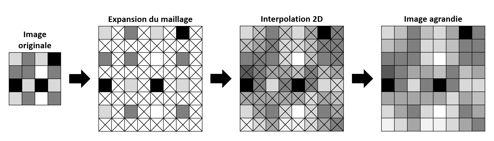

**Réduire** une image revient à **réduire sa fréquence d'échantillonnage** horizontale et verticale.
Il y a donc un **risque d'enfreindre le critère de Nyquist-Shannon !**

Pour réduire les dimensions d'une image par un facteur entier, on peut appliquer l'algorithme suivant :

|Réduction d'une image|
|:-|
|- On applique un **filtre passe-bas** "anti-aliasing" afin de respecter le critère de Nyquist-Shannon.|
|- On **décime** l'image en enlevant des lignes et des colonnes à la matrice avec un pas régulier.|

Voici une illustration de cet algorithme pour une image de $8 \times 8$ réduite pour faire $4 \times 4$ :

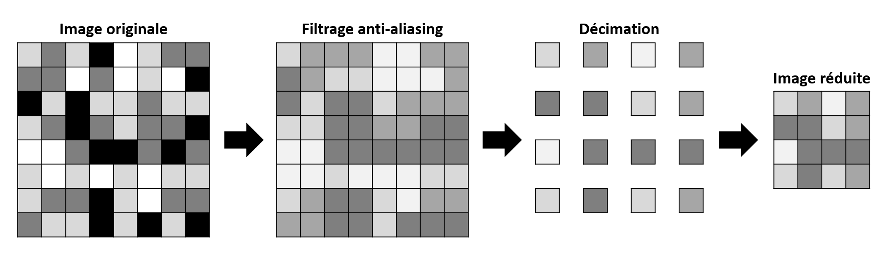

Dans le cas où les dimensions désirées ne correspondent pas à un facteur de réduction entier, la décimation ne suffit pas : on doit utiliser une méthode d'interpolation.

C'est pourquoi les méthodes de redimensionnement d'image impliquent en général de **choisir une technique d'interpolation 2D**.

Voici 4 techniques classiques :

* **Plus proches voisins** : le pixel interpolé prend la valeur du pixel le plus proche.

* **Bi-linéaire** : il s'agit d'une interpolation linéaire 2D à partir des 4 pixels voisins.

* **Bi-cubique** : il s'agit d'une interpolation cubique 2D à partir des 8 pixels voisins.

* **Lanczos** : le pixel est interpolé à partir des pixels voisins, avec des pondérations déterminées par une "fenêtre de Lanczos". 

Sous Python, on peut facilement redimensionner une image avec la méthode _resize_ de **Pillow**.

Mettons, que nous ayons importé une image avec **Pillow** sous la forme d'une variable _img_, et que nous voulons lui donner les dimensions $600 \times 600$.
Voici comment faire avec les 4 techniques d'interpolation que nous avons présentées :

~~~
img_resized_nearest = img.resize((600,600),Image.Resampling.NEAREST)
img_resized_bilinear = img.resize((600,600),Image.Resampling.BILINEAR)
img_resized_bicubic = img.resize((600,600),Image.Resampling.BICUBIC)
img_resized_lanczos = img.resize((600,600),Image.Resampling.LANCZOS)
~~~

Voici l'application de cette méthode avec différentes techniques d'interpolation pour augmenter les dimensions d'une version $100 \times 100$ de notre image d'un _Cynomys ludovicianus_ vers $500 \times 500$ :

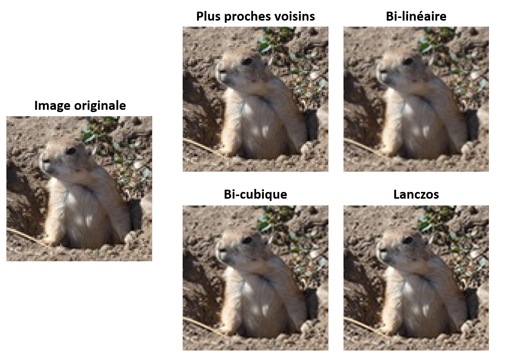

Et voici à présent l'application de la même méthode avec différentes techniques d'interpolation pour diminuer les dimensions d'une version $500 \times 500$ de notre image d'un _Cynomys ludovicianus_ vers $100 \times 100$ :

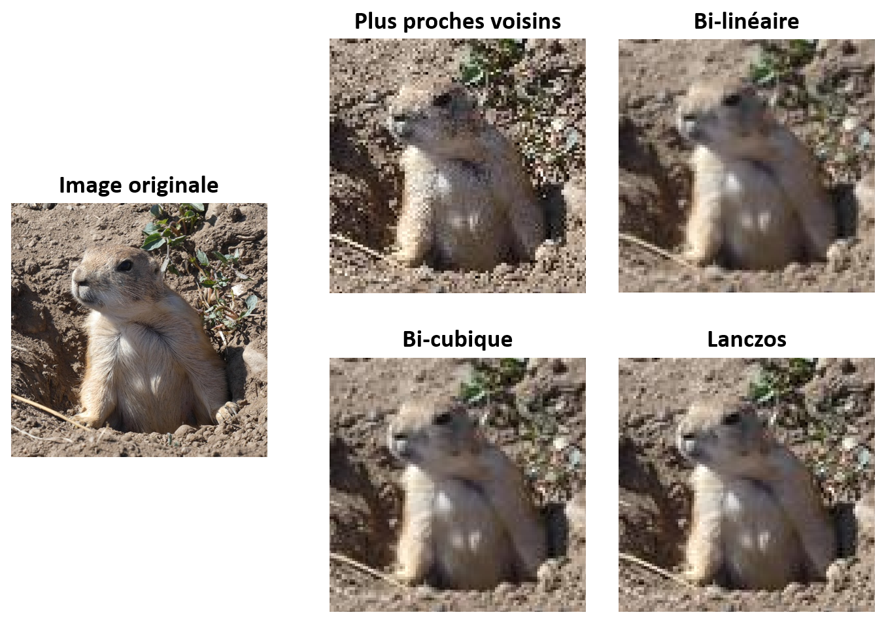

On peut faire les observations suivantes :

* La technique des "Plus proches voisins" est **la plus rapide**, mais elle donne un aspect "**pixelisé**" à l'image, ce qui en fait la méthode classique pour le "pixel art".

* La technique Lanczos est celle donnant le **meilleur résultat** sur notre exemple, mais elle est **plus coûteuse en calculs** et peut amplifier certains **artéfacts** dans l'image.

* Les techniques bi-linéaire et cubiques sont souvent considérées comme des **bons compromis**, la méthode bi-cubique donnant généralement un meilleur résultat.

|Nota Bene|
|:-|
|Lorsque l'on redimensionne une image, il faut bien garder à l'esprit que : |
|- **La réduction d'une image ne peut se faire sans perte d'information**.|
|- **L'agrandissement d'une image ne peut pas combler l'information manquante**.|

### Rotation / translation

Lorsqu'une application nécessite de **déplacer un objet à un emplacement donné** de l'image, par exemple pour le centrer, on utilise une combinaison de **translations horizontales et verticales**.

Il s'agit d'une opération très simple : on décale tous les pixels de l'image $I[x,y]$ d'un certain nombre de pas $\Delta x$ à l'horizontale et d'un certain nombre de pas $\Delta y$ à la verticale.

$I[x,y] = I[x - \Delta x , y - \Delta y]$

Mais il y a tout de même un problème : **que faire des pixels qui sortent de la matrice d'un côté, ou qui se retrouvent sans valeur de l'autre ?**

On utilise classiquement les 2 options suivantes :

* La **complétion par des zéros** : on peut supprimer les pixels qui sortent de la matrice, et compléter ceux qui se retrouvent sans valeur par des zéros.

* La **complétion cyclique** : on peut compléter les pixels sans valeurs et récupérant les pixels sortants, de manière à former un cycle.

Aucune des 2 options n'est idéale, on choisira l'une ou l'autre suivant les contraintes de notre application de vision par ordinateur.

Voici une illustration de ces 2 options pour une image de $8 \times 8$ :

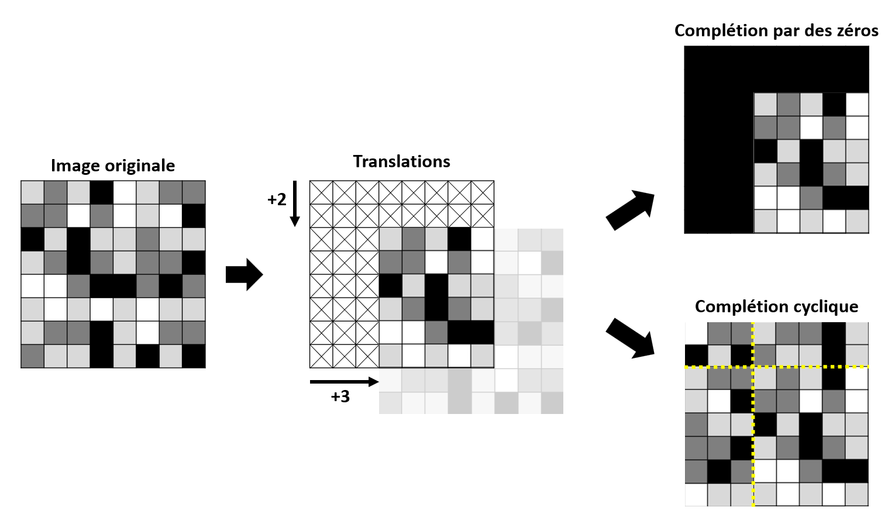

Sous Python, avec **Pillow**, on peut appliquer à une image importée _img_ une translation de 50 pixels vers la droite et de 100 pixels vers le bas, avec complétion par des zéros, en utilisant la méthode _transform_ :

~~~
largeur, hauteur = img.size

img_translation = img.transform((largeur,hauteur),Image.Transform.AFFINE,(1,0,-50,0,1,-100))
~~~

Le premier argument de _transform_ permet de conserver les dimensions de l'image.

Le second argument correspond aux paramètres de la transformation affine à réaliser pour notre translation 2D.
Si on note $x$ et $y$ les positions horizontales et verticales des pixels :

$x = 1x + 0y - 50$
$y = 0x + 1y - 100$

Pour une translation vers la gauche ou vers le haut, il suffit alors de changer le signe du 50 ou du 100.

Si on veut appliquer la même translation à _img_, mais avec complétion cyclique, il faut utiliser _ImageChops.offset_ de **Pillow** :

~~~
img_translation = ImageChops.offset(img,50,100)
~~~

Lorsqu'une application nécessite de **modifier l'orientation d'un objet** de l'image, on utilise une opération de **rotation**.

Appliquer une rotation d'un angle $\theta$ aux pixels d'une image $I[x,y]$ autour de son centre $(c_x,c_y)$ revient à :

$I[x,y] = I[c_x + (x-c_x) cos(\theta) + (y-c_y) sin(\theta) , c_y - (x-c_x) sin(\theta) + (y-c_y) cos(\theta)]$

Un premier problème de cette opération est que $c_x + (x-c_x) cos(\theta) + (y-c_y) sin(\theta) $ et $c_y - (x-c_x) sin(\theta) + (y-c_y) cos(\theta)$ peuvent donner des valeurs non entières.
**La rotation d'une image numérique implique donc forcément une interpolation 2D**.

Les 4 mêmes méthodes d'interpolation que pour le redimensionnement d'images peuvent être utilisées ("Plus proches voisins", bi-linéaire, bi-cubique, Lanczos).

Un second problème est que suivant les dimensions de l'image et l'angle de rotation, une partie des pixels peuvent sortir de la matrice.
Il y a alors 2 options :

* La **découpe** : on ignore simplement les pixels sortant de la matrice.

* L'**expansion** : quitte à interpoler l'image, on la redimensionne pour qu'elle rentre dans la matrice.

En général, les pixels se retrouvant sans valeurs sont complétés par des zéros.

Voici une illustration de ces 2 options pour une image $8 \times 8$ :

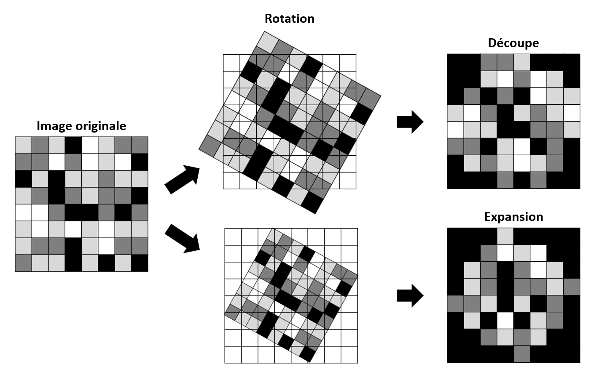

Sous Python, on peut appliquer à une image importée avec **Pillow** _img_ une rotation par un angle de 45° avec interpolation bi-cubique en utilisant la méthode _rotate_:

~~~
img_rotation = img.rotate(45,resample=Image.Resampling.BICUBIC)
~~~

Par défaut, il s'agit de l'option avec découpe.
Si l'on veut en plus utiliser l'option avec expansion, il faut utiliser :

~~~
img_rotation = img.rotate(45,resample=Image.Resampling.BICUBIC,expand=True)
~~~

Voici l'application de translations (classique ou cyclique) et de rotations (classique ou avec expansion) à notre image d'un _Cynomys ludovicianus_ :

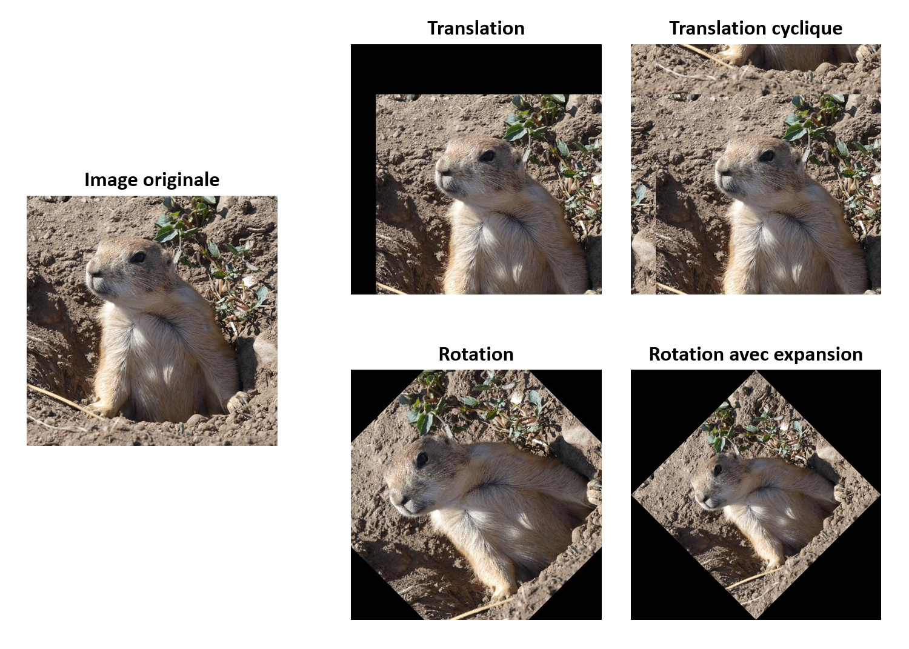

Une fois encore, pour la translation comme pour la rotation, aucune option n'est pleinement satisfaisante.
On choisira l'une ou l'autre selon les besoins d'une application de vision par ordinateur.

## Filtrage linéaire

### Définition

Comme évoqué lors du Chapitre 1, en vision par ordinateur on cherche à reproduire les mécanismes de la vision humaine avec des machines.
Certains traitements réalisés par le cortex visuel humain peuvent être approchés en traitement d'images numériques par ce que l'on appelle des **filtres linéaires**, et plus particulièrement les filtres linéaires "invariant".

Donc, de nombreux traitements classiques en traitement d'image peuvent être définis comme des filtres linéaire ou des combinaisons de filtres linéaires.
Il s'agit d'un principe essentiel en vision par ordinateur, nous verrons dans les chapitres qu'ils sont à la base des outils d'IA utilisés pour analyser des images.

En traitement d'image, un filtre linéaire est une fonction $f$ qui prend en entrée une image $I$ et renvoie une nouvelle image $S = f(I)$.
Elle a les propriétés suivantes :

* **Additivité** :  soit 2 images $I_1$ et $I_2$, alors $f(I_1+I_2) = f(I_1) + f(I_2)$.

* **Homogénéité** : soit $I$ une image et un scalaire $\alpha$, alors $f(\alpha I) = \alpha I$.

Et si le filtre est en plus invariant, il a la propriété suivante :

* **Invariance** : si $S[x,y] = f(I[x,y])$ alors pour toute translation horizontale $\Delta x$ et verticale $\Delta y$ on a $f(I[x - \Delta x , y - \Delta y]) = S[x - \Delta x , y - \Delta y]$.

Un filtre linéaire invariant est entièrement caractérisé par sa **réponse impulsionnelle** $h$, une matrice 2D aussi appellée **noyau de convolution** ou "**kernel**" :

$S[x,y] = \sum_{i=-\infty}^{\infty} \sum_{j=-\infty}^{\infty} h[i,j] I[x-i,y-j]$

Avec cette formulation, on part du principe que le kernel à des **indices centrés** : l'indice correspondant à son centre est (0,0).

C'est pourquoi on définit en général un filtre linéaire invariant par son kernel.

### Convolution

La formule précédente correspond à la version **discrètre** et *2D** d'une opération de **convolution** entre le kernel $h$ et l'image numérique $I$.

Pour simplifier, nous appellerons cette opération "convolution".
Nous la noterons $\ast$.

Voici quelques propriétés utiles de cette opération :

* **Commutativité** : soit 2 matrices $I$ et $J$, alors $I \ast J = J \ast I$.

* **Associativité** : soit 3 matrices $I$, $J$ et $K$, alors $I \ast (J \ast K) = (I \ast J) \ast K$.

* **Distributivité** : soit 3 matrices $I$, $J$ et $K$, alors $I \ast (J + K) = I \ast J + I \ast K$.

* **Homogénéité** : soit 2 matrices $I$ et $J$, et un scalaire $\alpha$k, alors $I \ast (\alpha J) = \alpha (I \ast J)$.

* **Invariance** (en translation) : soit 2 matrices $I$ et $J$, alors $(I \ast J)[x - \Delta x , y - \Delta y] = I[x - \Delta x , y - \Delta y] \ast J = I \ast J[x - \Delta x , y - \Delta y]$.

L'élément **identité** de la convolution est une **impulsion de Dirac** discrète et 2D :

$\delta[x,y]=
\begin{cases}
1 & \text{si } x=0 \text{ et } y=0,\\
0 & \text{sinon}.
\end{cases}$

Donc $I \ast \delta = I$, qui revient à dire qu'une convolution par une impulsion de Dirac ne change pas l'image d'origine.

Une autre propriété importante de la convolution est son lien avec la **transformée de Fourier**.
La transformée de Fourier d'une convolution et le produit des transformées de Fourier :

$\mathcal{F}(I \ast J) = \mathcal{F}(I) \mathcal{F}(J)$

Nous reparlerons de l'analyse spectrale des images par transformée de Fourier dans la suite de ce chapitre.

En pratique, utiliser un kernel de dimensions infinies est bien entendu impossible.
C'est pourquoi on approxime la réponse impulsionnelle du filtrage désiré par un **kernel de dimensions finies**.

Par exemple, pour un kernel $h$ de dimensions $(2k+1) \times (2k+1)$, la convolution avec une image $I$ devient :

$S[x,y] = \sum_{i=-k}^{k} \sum_{j=-k}^{k} h[i,j] I[x-i,y-j]$

Une image étant une matrice 2D finie, si nous appliquons cette formule à tous les pixels de l'image, certains pixels $I[x-i,y-j]$ n'existeront pas.
Alors comment gérer ces **cas sur les bords** ?

Pour permettre à la matrice de sortie $S$ d'avoir les mêmes dimensions que l'image d'origine, on va en général ajouter des lignes et des colonnes à $I$ de manière à ce que la convolution puisse s'appliquer à tous les pixels de l'image.
Cette extension de $I$ peut se faire différentes façons :

* **Complétion par des zéros** : on met juste les pixels ajoutés à zéro.

* **Complétion par répétition** : on répète les pixels situés sur les bords de l'image.

* **Complétion par symétrie** : on reproduit les pixels de l'image par symétrie sur les bords.

* **Complétion circulaire** : on considère l'image comme étant périodique, et on prolonge donc les pixels au-delà d'un bord par ceux du bord opposé.

Cette dernière option est la plus couramment utilisée.
On définit même une opération de **convolution circulaire**, notée $\circledast$. 

Pour une image $I$ de dimensions $M \times N$, la convolution circulaire par un kernel $h$ de dimensions $(2k+1) \times (2k+1)$ sera définie comme : 

$S[x,y] = \sum_{i=-k}^{k} \sum_{j=-k}^{k} h[i,j] I[x-i \bmod M , y-j \bmod N]$

Et $S$ aura bien les mêmes dimensions que $I$.

Voici une illustration du fonctionnement de la convolution circulaire d'une image par un kernel :

L'avantage de la convolution circulaire est qu'elle permet de conserver la propriété suivante, vis-à-vis de la **Transformée de Fourier Discrète** (TFD) :

$TFD(I \circledast J) = TFD(I) TFD(J)$

|Nota Bene|
|:-|
|On peut aussi choisir d'appliquer la convolution à $I$ sans extansion.|
|Alors, la matrice $S$ aura des **dimensions plus faibles** que $I$, de $-2k$.|
|Ce sera le choix des méthodes d'IA que nous verrons aux chapitres suivants.|

### Choix du kernel

Nous allons voir quelques exemples classiques de kernels $3 \times 3$ en traitement du signal.

Tout d'abord, comme nous l'avions évoqué plus tôt, l'**idendité** pour la convolution est une impulsion de Dirac.
Pour un kernel $3 \times 3$, ceci revient à une convolution circulaire par la matrice :

$\begin{pmatrix}
0 & 0 & 0 \\
0 & 1 & 0 \\
0 & 0 & 0 \\
\end{pmatrix}$

Après application d'une convolution circulaire à une matrice $I$ avec ce kernel, on obtient $S = I$.
L'identité est donc rarement utilisée seule, mais plutôt combinée avec d'autres filtrages linéaires.

Une application typique du filtrage linéaire d'images numériques est le **lissage**.

Il s'agit de **réduire les composantes haute fréquence** horizontales et verticales de l'image.
Ce type de filtrage peut avoir différentes utilités : réduire l'impact du bruit, faire ressortir les grands objets plutôt que les petits détails, anti-aliasing, etc.

Ceci peut être fait par convolution avec un kernel remplaçant chaque pixel de l'image par une **moyenne** des pixels dans le voisinage $3 \times 3$.
Voici les 2 principaux types de moyennes utilisées :

* Le filtre "**box**", qui réalise simplement une moyenne arithmétique des valeurs du pixel et de ses 8 voisins :

$\frac{1}{9} 
\begin{pmatrix}
1 & 1 & 1 \\
1 & 1 & 1 \\
1 & 1 & 1 \\
\end{pmatrix}$

* Le filtre "**gaussien**", qui approxime une pondération gaussienne 2D des valeurs du pixel et de ses 8 voisins :

$\frac{1}{16} 
\begin{pmatrix}
1 & 2 & 1 \\
2 & 4 & 2 \\
1 & 2 & 1 \\
\end{pmatrix}$

Le filtre "box" est plus simple mais moins efficace que le filtre "gaussien" pour lisser une image.

Une autre application typique du filtrage linéaire d'images numériques est la **détection de contours**.

Il s'agit ici de faire ressortir les transitions entre différentes zones de l'image, en utilisant les **dérivées de l'image** par rapport à l'axe horizontal et l'axe vertical.
L'idée est qu'à la frontière entre 2 zones de l'image, la dérivée sera élevée, et elle le sera d'autant plus que le contraste entre les 2 zones est grand.

En $3 \times 3$, une dérivée horizontale peut être approximée par le kernel $\begin{pmatrix} -1 & 0 & 1 \end{pmatrix}$, et une dérivée verticale par le kernel $\begin{pmatrix} -1 \\ 0 \\ 1 \end{pmatrix}$.

Voici les 3 principaux types de dérivations utilisées en pratique :

* Les 2 filtres de **Sobel**, avec le kernel $G_x$ combinant une dérivation horizontale et un lissage vertical, et le kernel $G_y$ combinant une dérivation verticale et un lissage horizontal :

$G_x = 
\begin{pmatrix}
-1 & 0 & 1 \\
-2 & 0 & 2 \\
-1 & 0 & 1 \\
\end{pmatrix}$

$G_y = 
\begin{pmatrix}
-1 & -2 & -1 \\
0 & 0 & 0 \\
1 & 2 & 1 \\
\end{pmatrix}$

$G_x$ permet de faire ressortir les contours **verticaux**, et $G_y$ les contours **horizontaux**.

* Le filtre "**Laplacien à 4 voisins**", et une approximation de l'opérateur Laplacien en 2D (addition de la dérivée seconde horizontale et de la dérivée seconde verticale) avec 4 pixels voisins :

$\begin{pmatrix}
0 & -1 & 0 \\
-1 & 4 & -1 \\
0 & -1 & 0 \\
\end{pmatrix}$

* Le filtre "**Laplacien à 8 voisins**", et également une approximation de l'opérateur Laplacien en 2D, mais avec les 8 pixels voisins :

$\begin{pmatrix}
-1 & -1 & -1 \\
-1 & 8 & -1 \\
-1 & -1 & -1 \\
\end{pmatrix}$

Avec ce type de kernels, nous faisons ressortir les contours, mais nous ne réalisons pas une réellement une "détection" de contours, dans le sens où nous n'extrayons pas les positions des contours.
Nous verrons dans la suite de ce chapitre des méthodes de "détection de contours" à proprement parler.

Enfin, une dernière application typique du filtrage linéaire d'images numériques est l'**amélioration de la netteté**.

Là où le lissage va donner un aspect flou en faisant ressortir les composantes basse fréquence de l'image, un filtre d'amélioration de la netteté va faire **ressortir les composantes haute fréquence**.
Pour ce faire, une technique possible est de **renforcer les contours** dans l'image, en additionnant l'image originale avec l'image obtenue après filtrage pour de la détection de contours.

La convolution étant distributive :

$I + I \circledast
\begin{pmatrix}
0 & -1 & 0 \\
-1 & 4 & -1 \\
0 & -1 & 0 \\
\end{pmatrix}
= I \circledast
\left(\begin{pmatrix}
0 & 0 & 0 \\
0 & 1 & 0 \\
0 & 0 & 0 \\
\end{pmatrix}
+ \begin{pmatrix}
0 & -1 & 0 \\
-1 & 4 & -1 \\
0 & -1 & 0 \\
\end{pmatrix}\right)$

D'où le kernel suivant pour améliorer la netteté d'une image numérique :

$\begin{pmatrix}
0 & -1 & 0 \\
-1 & 5 & -1 \\
0 & -1 & 0 \\
\end{pmatrix}$

Sous Python, avec **Pillow**, on peut appliquer une convolution par un kernel _ker_ à une image _img_ avec _ImageFilter.Kernel_ :

~~~
filt = ImageFilter.Kernel(size=(3,3),kernel=kernel,scale=1)

img_filtered = img.filter(filt)
~~~

La première commande définit le filtre linéaire (avec ses dimensions, son kernel, et optionnellement un facteur d'échelle), la seconde l'applique à l'image.

Cette méthode ne fonctionne que pour des kernels $3 \times 3$ et $5 \times 5$, qui sont les dimensions les plus classiques.
Mais **Pillow** possède aussi de nombreuses implémentations de filtres avec des kernel pré-définis.

**OpenCV** possède une méthode _filter2D_ pour l'application d'un filtre linéaire à partir d'un kernel donné, qui est un peu plus flexible.

Voici quelques exemples d'application de filtre linéaires à notre image d'un _Cynomys ludovicianus_ :

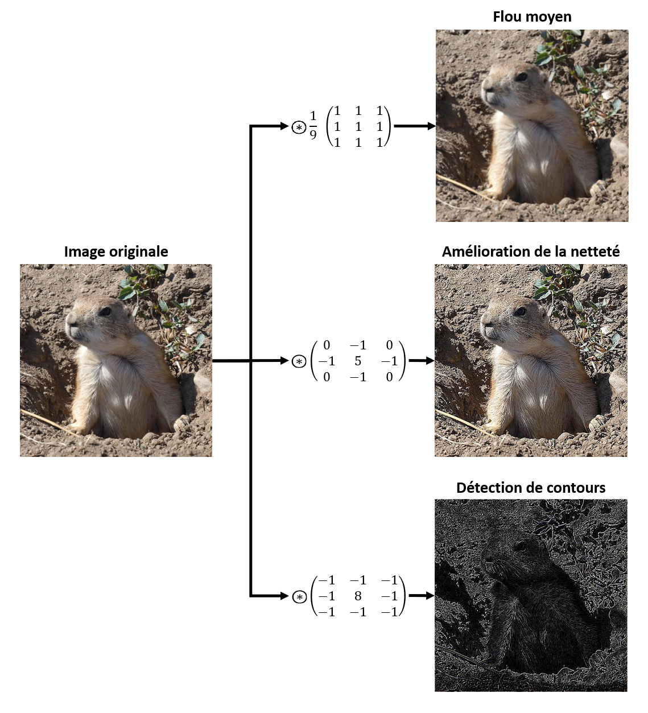

|Nota Bene|
|:-|
|Nous avons vu ici des exemples de kernels $3 \times 3$, mais **plus le kernel choisi est grand, meilleure est l'approximation de la réponse impulsionnelle recherchée**.|
|Aussi, les manipulations géométriques vues précédemment peuvent être en partie définies par des filtrages linéaires, notamment les étapes de **filtrage anti-aliasing** et d'**interpolation**.|

## FFT et filtrage fréquentiel

### Analyse spectrale d'une image

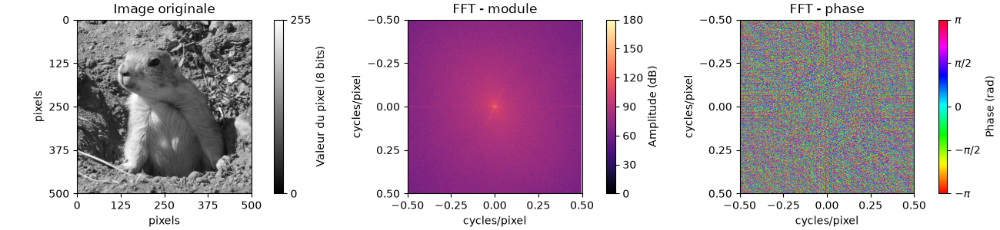

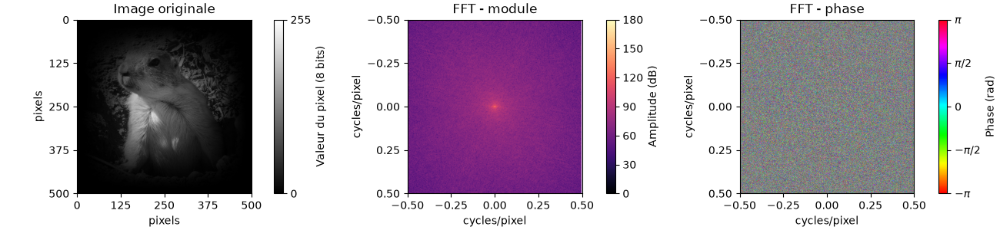

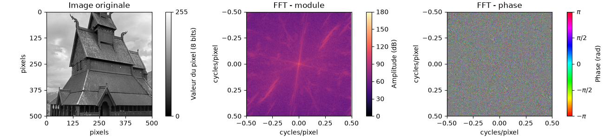

### Filtrage en fréquences d'une image

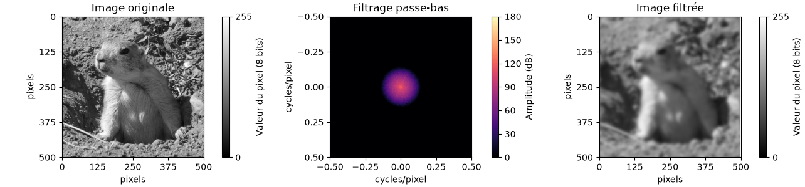

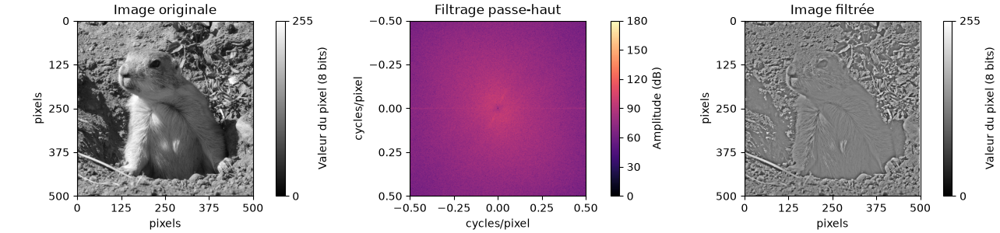

## Opérations morphologiques

### Element structurant

### Filtre médian

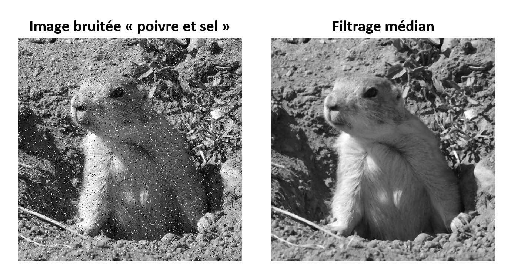

### Erosion et dilatation

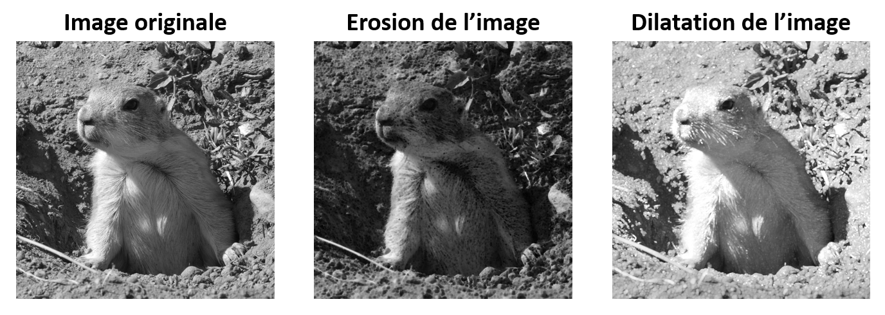

### Ouverture et fermeture

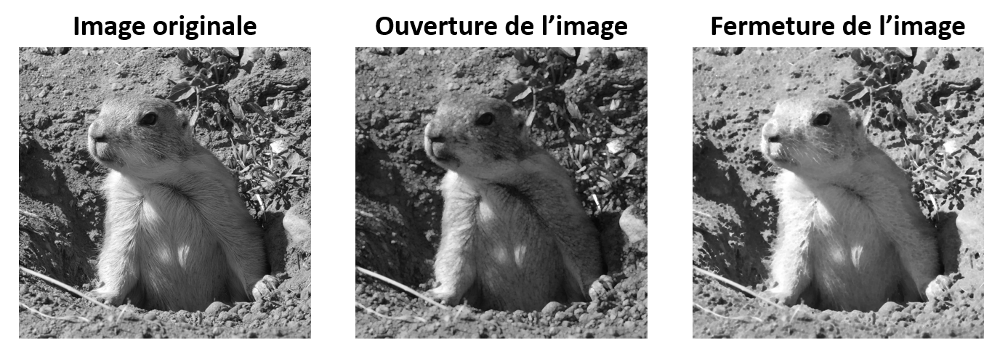

## Détection de contours ou de coins

### Filtre de Sobel

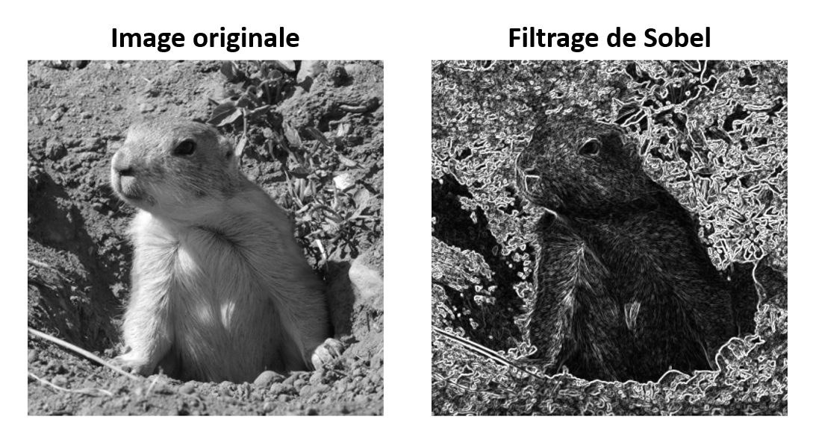

### Filtre de Canny

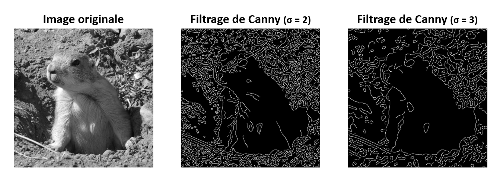

### Filtre de Harris

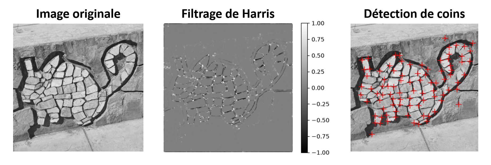

## Détection de forme

### La transformée de Hough

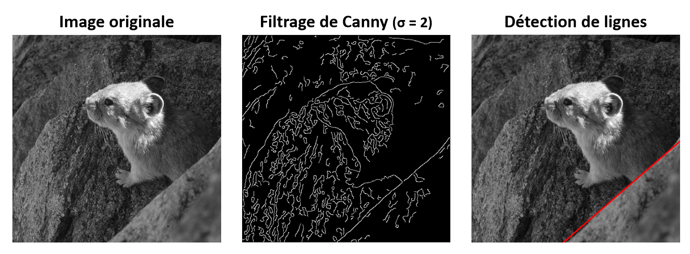

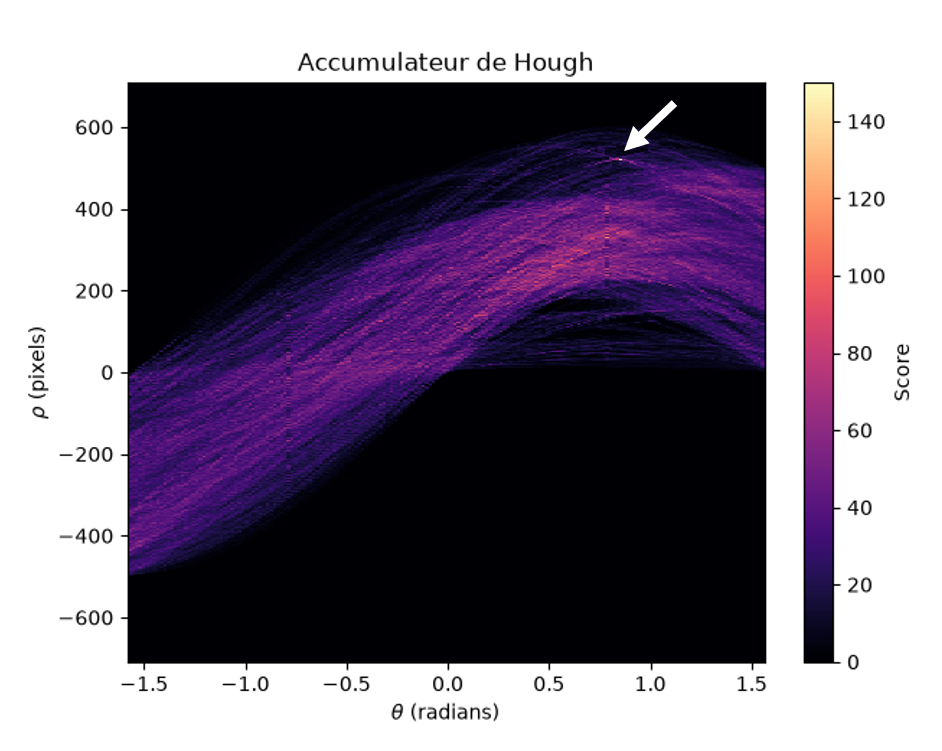

### Adaptation aux cercles

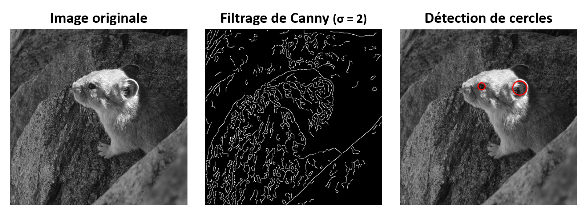

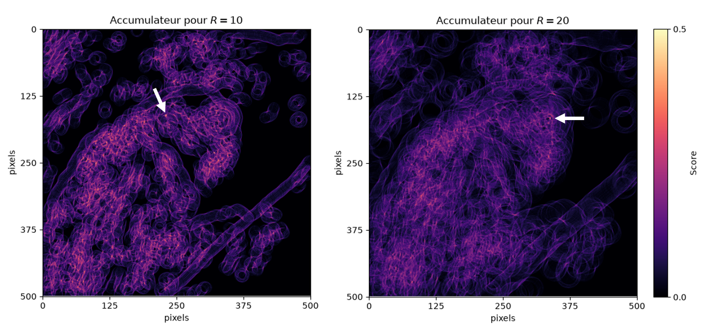

### Généralisation