# Chapitre II : Le traitement d'images, l'art du filtrage et de la transformation

Ce chapitre abordera les fondamentaux du traitement d'images numériques.
Il introduira entre autres les filtres et transformées qui sont à la base des outils "d'apprentissage profond" (ou "Deep Learning" en anglais) utilisés en "vision par ordinateur".

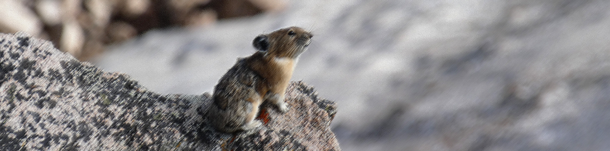

_"Vibre la lumière, Chantez les couleurs, Il y met sa vie, Le bruit de son coeur._

_Et comme un bateau, Porté par sa voile, Doucement le pinceau, Glisse sur la toile._

_Et voilà l'homme, Qui croise avec ses yeux, Le temps d'un éclair, Le regard des dieux._

_Cézanne peint, Il laisse s'accomplir le prodige de ses mains._

_Cézanne peint, Et il éclaire le monde pour nos yeux qui n'voient rien."_

**Michel Berger & France Gall, Cézanne peint, 1985**

---

## Images exemples

Ce chapitre sera illustré par quelques images exemples.

Vous trouverez la première [ici](https://github.com/NicOudart/UVSQ_EN3901_computer_vision/blob/master/images/Prairie_dog.jpg).

Il s'agit d'une photographie d'un _Cynomys ludovicianus_, aussi connu sous le nom de "Black-tailed Prairie Dog", prise en 2022 à Boulder (Colorado, USA).

Par défaut, nous utiliserons cette image pour illustrer les différentes méthodes de traitement d'images.

Dans les cas spécifiques où nous avons besoin d'une image contenant des contours ou des coins bien définis, nous utiliserons une seconde image que vous trouverez [ici](https://github.com/NicOudart/UVSQ_EN3901_computer_vision/blob/master/images/Vizcacha.jpg).

Il s'agit d'une photographie d'une mosaïque représentant une _Lagidium peruanum_, aussi connue sous le nom de "Vizcacha del Norte", prise en 2025 à Huancayo (Pérou).

Et dans les cas spécifiques où nous avons besoin d'une image avec des lignes ou des cercles à détecter, nous utiliserons une troisième image que vous trouverez [ici](https://github.com/NicOudart/UVSQ_EN3901_computer_vision/blob/master/images/Pika.jpg).

Il s'agit d'une photographie d'un _Ochotona princeps_, aussi connu sous le nom d' "American Pika", prise en 2022 au Rocky Mountain National Park (Colorado, USA).

N'hésitez pas à aller regarder les détails de la prise de vue des différentes photographies dans les métadonnées des images !

## Le traitement d'image

Lors du chapitre précédent, nous avons introduit le concept de "vision". 
Puis, nous avons parlé des problématiques liées à l'acquisition d'image avec une caméra.
Ensuite, nous avons parlé des problématiques liées à l'enregistrement d'images sous forme numérique.
Et enfin, nous avons introduit les concepts de "retouche" et "d'étalonnage" d'images.

La suite logique dans n'importe quel projet de vision par ordinateur est le **traitement d'image**.
Il s'agit de l'ensemble des **méthodes mathématiques** et **algorithmiques** "classiques" (hors IA) appliquables à des **images numériques** afin de les adapter à une méthode d'analyse, en faisant **ressortir des informations pertinentes**.

L'idée est qu'une image peut être considérée comme un signal discret 2D, et par conséquent on peut lui appliquer :

* Des manipulations **géométriques**, permettant d'adapter l'image selon un besoin spécifique en termes de dimensions, d'orientation, ou de translation spatiale.

* Des **filtres**, qui viennent modifier les valeurs des pixels de l'image pour faire **ressortir certaines propriétes spatiales** de l'image (les petits ou les gros élements, les contours, les coins, etc.).

* Des **transformations**, qui donnent accès à des **espaces de représentation différents** pour un image, permettant ainsi d'en tirer des **caractéristiques spatiales quantitatives** (fréquences horizontales ou verticales, lignes, cercles, etc.).

Ce chapitre vous présentera les outils de base en traitement d'image.
Il ne s'agira pas ici d'être exhaustif.
Nous nous attarderons en particulier sur les méthodes qui sont à l'origine de l'analyse d'images par IA, qui sera le sujet des 2 derniers chapitres de ce cours.

## Manipulations géométriques

Certaines applications de vision par ordinateur nécessitent d'adapter la dimension d'une image, de déplacer un objet sur une image, ou de changer son orientation.
Nous allons voir comment réaliser ces manipulations géométriques de base, et ce qu'elles impliquent en termes de reconstitution du signal contenu dans l'image.

### Agrandissement / réduction

Comme mentionné plus tôt, on peut considérer une image numérique comme un **signal 2D discret**.
Par conséquent, modifier les dimensions d'une image numérique revient à **rééchantillonner** ce signal.

C'est ce que l'on appelle du "**redimensionnement d'image**".
Lorsque l'on cherche à augmenter les dimensions d'une image (et donc son nombre d'échantillons), on parle d'un "**agrandissement**".
Lorsque l'on cherche à diminuer les dimensions d'une image (et donc son nombre d'échantillons), on parle d'une "**réduction**".

La grande problématique du redimensionnement d'image est de respecter le **théorème de Nyquist-Shannon** vu au chapitre précédent : pour représenter discrètement un signal n'ayant pas de composantes fréquentielles supérieures à $f_{max}$, il faut choisir une fréquence d'échantillonnage $f_s$ telle que $f_s > 2 f_{max}$.

Une image étant un signal 2D discret, il faut donc que la fréquence d'échantillonnage respecte ce critère vis-à-vis de la plus grand fréquence spatiale contenue dans l'image, **selon les axes horizontaux et verticaux**.
Pour rappel, si ce critère n'est pas respecté lors du redimensionnement, l'image redimensionnée risque de souffrir d'un phénomène appelé **aliasing**, qui sera visible sous la forme d'artefacts appelé "Moiré".

**Agrandir** une image revient à **augmenter sa fréquence d'échantillonnage** horizontale et verticale.
Il n'y a donc **aucun de risque d'enfreindre le critère de Nyquist-Shannon**.

Pour agrandir une image on va donc simplement appliquer l'algorithme suivant :

|Agrandissement d'une image|
|:-|
|- On **étend le maillage** de l'image en augmentant le nombre de lignes et de colonnes de la matrice par l'insertion de zéros avec un pas régulier.|
|- On **interpole** les valeurs de l'image initiale pour compléter les zéros.|

Voici une illustration de cet algorithme pour une image de $4 \times 4$ pixels agrandie pour faire $8 \times 8$ :

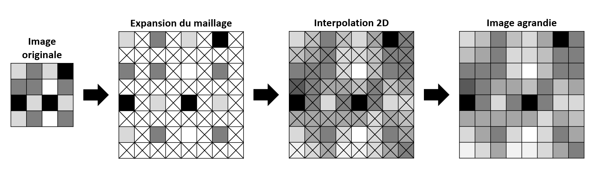

**Réduire** une image revient à **réduire sa fréquence d'échantillonnage** horizontale et verticale.
Il y a donc un **risque d'enfreindre le critère de Nyquist-Shannon !**

Pour réduire les dimensions d'une image par un facteur entier, on peut appliquer l'algorithme suivant :

|Réduction d'une image|
|:-|
|- On applique un **filtre passe-bas** "anti-aliasing" afin de respecter le critère de Nyquist-Shannon.|
|- On **décime** l'image en enlevant des lignes et des colonnes à la matrice avec un pas régulier.|

Voici une illustration de cet algorithme pour une image de $8 \times 8$ réduite pour faire $4 \times 4$ :

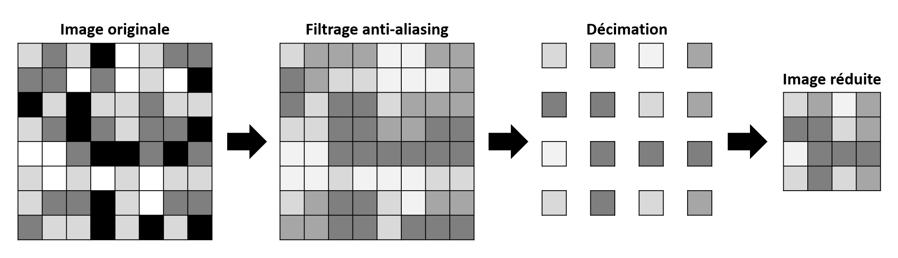

Dans le cas où les dimensions désirées ne correspondent pas à un facteur de réduction entier, la décimation ne suffit pas : on doit utiliser une méthode d'interpolation.

C'est pourquoi les méthodes de redimensionnement d'image impliquent en général de **choisir une technique d'interpolation 2D**.

Voici 4 techniques classiques :

* **Plus proches voisins** : le pixel interpolé prend la valeur du pixel le plus proche.

* **Bi-linéaire** : il s'agit d'une interpolation linéaire 2D à partir des 4 pixels voisins.

* **Bi-cubique** : il s'agit d'une interpolation cubique 2D à partir des 8 pixels voisins.

* **Lanczos** : le pixel est interpolé à partir des pixels voisins, avec des pondérations déterminées par une "fenêtre de Lanczos". 

Sous Python, on peut facilement redimensionner une image avec la méthode _resize_ de **Pillow**.

Mettons, que nous ayons importé une image avec **Pillow** sous la forme d'une variable _img_, et que nous voulons lui donner les dimensions $600 \times 600$.
Voici comment faire avec les 4 techniques d'interpolation que nous avons présentées :

~~~
img_resized_nearest = img.resize((600,600),Image.Resampling.NEAREST)
img_resized_bilinear = img.resize((600,600),Image.Resampling.BILINEAR)
img_resized_bicubic = img.resize((600,600),Image.Resampling.BICUBIC)
img_resized_lanczos = img.resize((600,600),Image.Resampling.LANCZOS)
~~~

Voici l'application de cette méthode avec différentes techniques d'interpolation pour augmenter les dimensions d'une version $100 \times 100$ de notre image d'un _Cynomys ludovicianus_ vers $500 \times 500$ :

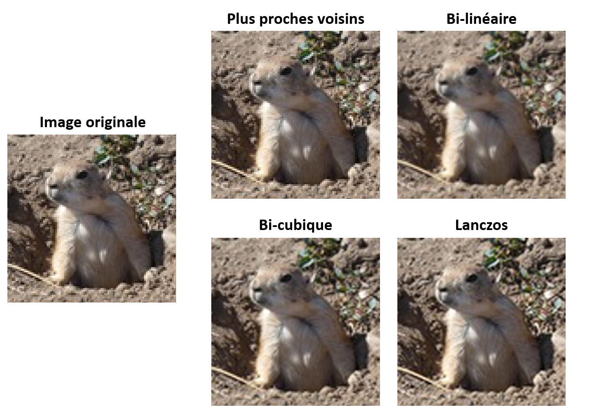

Et voici à présent l'application de la même méthode avec différentes techniques d'interpolation pour diminuer les dimensions d'une version $500 \times 500$ de notre image d'un _Cynomys ludovicianus_ vers $100 \times 100$ :

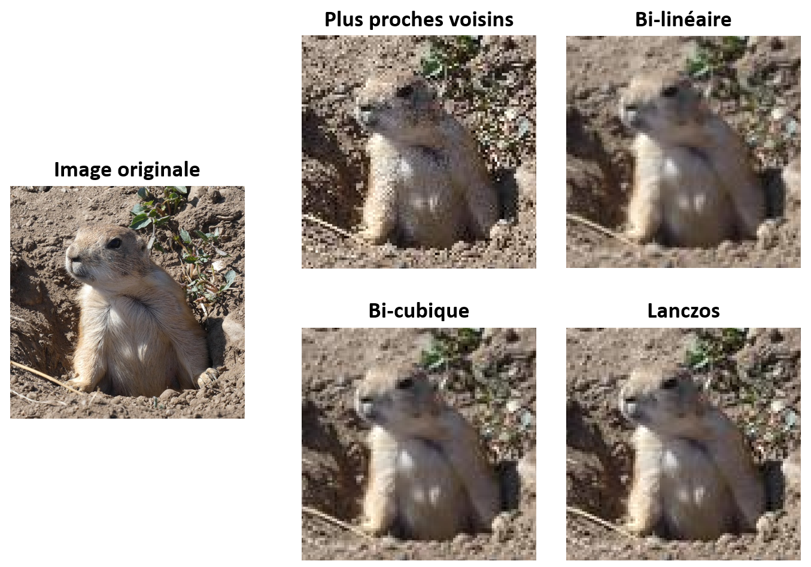

On peut faire les observations suivantes :

* La technique des "Plus proches voisins" est **la plus rapide**, mais elle donne un aspect "**pixelisé**" à l'image, ce qui en fait la méthode classique pour le "pixel art".

* La technique Lanczos est celle donnant le **meilleur résultat** sur notre exemple, mais elle est **plus coûteuse en calculs** et peut amplifier certains **artéfacts** dans l'image.

* Les techniques bi-linéaire et cubiques sont souvent considérées comme des **bons compromis**, la méthode bi-cubique donnant généralement un meilleur résultat.

|Nota Bene|
|:-|
|Lorsque l'on redimensionne une image, il faut bien garder à l'esprit que : |
|- **La réduction d'une image ne peut se faire sans perte d'information**.|
|- **L'agrandissement d'une image ne peut pas combler l'information manquante**.|

### Rotation / translation

Lorsqu'une application nécessite de **déplacer un objet à un emplacement donné** de l'image, par exemple pour le centrer, on utilise une combinaison de **translations horizontales et verticales**.

Il s'agit d'une opération très simple : on décale tous les pixels de l'image $I[x,y]$ d'un certain nombre de pas $\Delta x$ à l'horizontale et d'un certain nombre de pas $\Delta y$ à la verticale.

$I[x,y] = I[x - \Delta x , y - \Delta y]$

Mais il y a tout de même un problème : **que faire des pixels qui sortent de la matrice d'un côté, ou qui se retrouvent sans valeur de l'autre ?**

On utilise classiquement les 2 options suivantes :

* La **complétion par des zéros** : on peut supprimer les pixels qui sortent de la matrice, et compléter ceux qui se retrouvent sans valeur par des zéros.

* La **complétion cyclique** : on peut compléter les pixels sans valeurs et récupérant les pixels sortants, de manière à former un cycle.

Aucune des 2 options n'est idéale, on choisira l'une ou l'autre suivant les contraintes de notre application de vision par ordinateur.

Voici une illustration de ces 2 options pour une image de $8 \times 8$ :

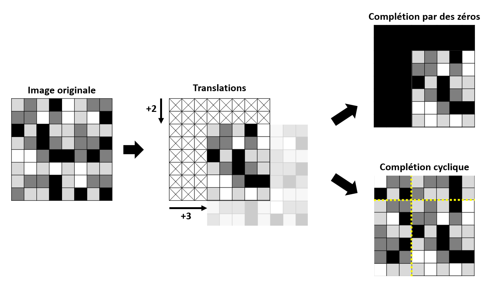

Sous Python, avec **Pillow**, on peut appliquer à une image importée _img_ une translation de 50 pixels vers la droite et de 100 pixels vers le bas, avec complétion par des zéros, en utilisant la méthode _transform_ :

~~~
largeur, hauteur = img.size

img_translation = img.transform((largeur,hauteur),Image.Transform.AFFINE,(1,0,-50,0,1,-100))
~~~

Le premier argument de _transform_ permet de conserver les dimensions de l'image.

Le second argument correspond aux paramètres de la transformation affine à réaliser pour notre translation 2D.
Si on note $x$ et $y$ les positions horizontales et verticales des pixels :

$x = 1x + 0y - 50$
$y = 0x + 1y - 100$

Pour une translation vers la gauche ou vers le haut, il suffit alors de changer le signe du 50 ou du 100.

Si on veut appliquer la même translation à _img_, mais avec complétion cyclique, il faut utiliser _ImageChops.offset_ de **Pillow** :

~~~
img_translation = ImageChops.offset(img,50,100)
~~~

Lorsqu'une application nécessite de **modifier l'orientation d'un objet** de l'image, on utilise une opération de **rotation**.

Appliquer une rotation d'un angle $\theta$ aux pixels d'une image $I[x,y]$ autour de son centre $(c_x,c_y)$ revient à :

$I[x,y] = I[c_x + (x-c_x) cos(\theta) + (y-c_y) sin(\theta) , c_y - (x-c_x) sin(\theta) + (y-c_y) cos(\theta)]$

Un premier problème de cette opération est que $c_x + (x-c_x) cos(\theta) + (y-c_y) sin(\theta)$ et $c_y - (x-c_x) sin(\theta) + (y-c_y) cos(\theta)$ peuvent donner des valeurs non entières.
**La rotation d'une image numérique implique donc forcément une interpolation 2D**.

Les 4 mêmes méthodes d'interpolation que pour le redimensionnement d'images peuvent être utilisées ("Plus proches voisins", bi-linéaire, bi-cubique, Lanczos).

Un second problème est que suivant les dimensions de l'image et l'angle de rotation, une partie des pixels peuvent sortir de la matrice.
Il y a alors 2 options :

* La **découpe** : on ignore simplement les pixels sortant de la matrice.

* L'**expansion** : quitte à interpoler l'image, on la redimensionne pour qu'elle rentre dans la matrice.

En général, les pixels se retrouvant sans valeurs sont complétés par des zéros.

Voici une illustration de ces 2 options pour une image $8 \times 8$ :

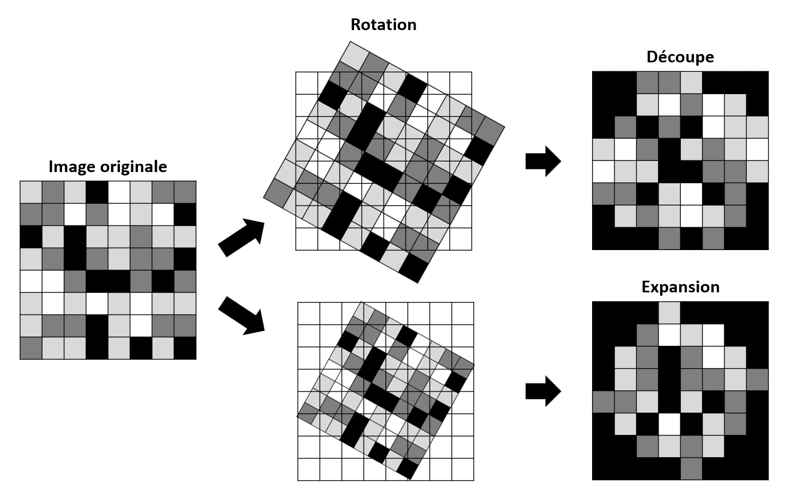

Sous Python, on peut appliquer à une image importée avec **Pillow** _img_ une rotation par un angle de 45° avec interpolation bi-cubique en utilisant la méthode _rotate_:

~~~
img_rotation = img.rotate(45,resample=Image.Resampling.BICUBIC)
~~~

Par défaut, il s'agit de l'option avec découpe.
Si l'on veut en plus utiliser l'option avec expansion, il faut utiliser :

~~~
img_rotation = img.rotate(45,resample=Image.Resampling.BICUBIC,expand=True)
~~~

Voici l'application de translations (classique ou cyclique) et de rotations (classique ou avec expansion) à notre image d'un _Cynomys ludovicianus_ :

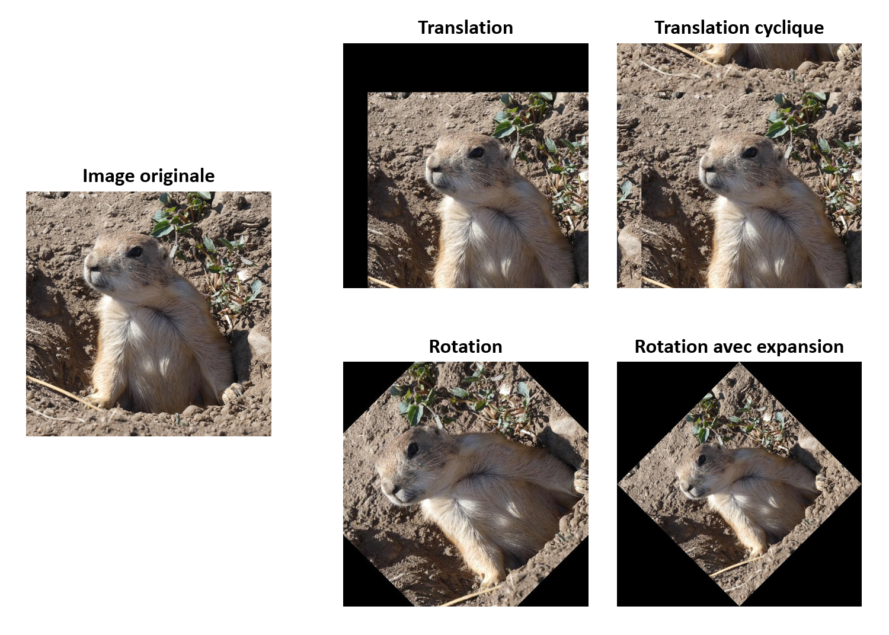

Une fois encore, pour la translation comme pour la rotation, aucune option n'est pleinement satisfaisante.
On choisira l'une ou l'autre selon les besoins d'une application de vision par ordinateur.

## Filtrage linéaire

### Définition

Comme évoqué lors du Chapitre 1, en vision par ordinateur on cherche à reproduire les mécanismes de la vision humaine avec des machines.
Certains traitements réalisés par le cortex visuel humain peuvent être approchés en traitement d'images numériques par ce que l'on appelle des **filtres linéaires**, et plus particulièrement les filtres linéaires "invariant".

Donc, de nombreux traitements classiques en traitement d'image peuvent être définis comme des filtres linéaire ou des combinaisons de filtres linéaires.
Il s'agit d'un principe essentiel en vision par ordinateur, nous verrons dans les chapitres qu'ils sont à la base des outils d'IA utilisés pour analyser des images.

En traitement d'image, un filtre linéaire est une fonction $f$ qui prend en entrée une image $I$ et renvoie une nouvelle image $S = f(I)$.
Elle a les propriétés suivantes :

* **Additivité** :  soit 2 images $I_1$ et $I_2$, alors $f(I_1+I_2) = f(I_1) + f(I_2)$.

* **Homogénéité** : soit $I$ une image et un scalaire $\alpha$, alors $f(\alpha I) = \alpha I$.

Et si le filtre est en plus invariant, il a la propriété suivante :

* **Invariance** : si $S[x,y] = f(I[x,y])$ alors pour toute translation horizontale $\Delta x$ et verticale $\Delta y$ on a $f(I[x - \Delta x , y - \Delta y]) = S[x - \Delta x , y - \Delta y]$.

Un filtre linéaire invariant est entièrement caractérisé par sa **réponse impulsionnelle** $h$, une matrice 2D aussi appellée **noyau de convolution** ou "**kernel**" :

$S[x,y] = \sum_{i=-\infty}^{\infty} \sum_{j=-\infty}^{\infty} h[i,j] I[x-i,y-j]$

Avec cette formulation, on part du principe que le kernel à des **indices centrés** : l'indice correspondant à son centre est (0,0).

C'est pourquoi on définit en général un filtre linéaire invariant par son kernel.

### Convolution

La formule précédente correspond à la version **discrètre** et *2D** d'une opération de **convolution** entre le kernel $h$ et l'image numérique $I$.

Pour simplifier, nous appellerons cette opération "convolution".
Nous la noterons $\ast$.

Voici quelques propriétés utiles de cette opération :

* **Commutativité** : soit 2 matrices $I$ et $J$, alors $I \ast J = J \ast I$.

* **Associativité** : soit 3 matrices $I$, $J$ et $K$, alors $I \ast (J \ast K) = (I \ast J) \ast K$.

* **Distributivité** : soit 3 matrices $I$, $J$ et $K$, alors $I \ast (J + K) = I \ast J + I \ast K$.

* **Homogénéité** : soit 2 matrices $I$ et $J$, et un scalaire $\alpha$k, alors $I \ast (\alpha J) = \alpha (I \ast J)$.

* **Invariance** (en translation) : soit 2 matrices $I$ et $J$, alors $(I \ast J)[x - \Delta x , y - \Delta y] = I[x - \Delta x , y - \Delta y] \ast J = I \ast J[x - \Delta x , y - \Delta y]$.

L'élément **identité** de la convolution est une **impulsion de Dirac** discrète et 2D :

$\delta[x,y]=
\begin{cases}
1 & \text{si } x=0 \text{ et } y=0,\\
0 & \text{sinon}.
\end{cases}$

Donc $I \ast \delta = I$, qui revient à dire qu'une convolution par une impulsion de Dirac ne change pas l'image d'origine.

Une autre propriété importante de la convolution est son lien avec la **transformée de Fourier**.
La transformée de Fourier d'une convolution et le produit des transformées de Fourier :

$\mathcal{F}(I \ast J) = \mathcal{F}(I) \mathcal{F}(J)$

Nous reparlerons de l'analyse spectrale des images par transformée de Fourier dans la suite de ce chapitre.

En pratique, utiliser un kernel de dimensions infinies est bien entendu impossible.
C'est pourquoi on approxime la réponse impulsionnelle du filtrage désiré par un **kernel de dimensions finies**.

Par exemple, pour un kernel $h$ de dimensions $(2k+1) \times (2k+1)$, la convolution avec une image $I$ devient :

$S[x,y] = \sum_{i=-k}^{k} \sum_{j=-k}^{k} h[i,j] I[x-i,y-j]$

Une image étant une matrice 2D finie, si nous appliquons cette formule à tous les pixels de l'image, certains pixels $I[x-i,y-j]$ n'existeront pas.
Alors comment gérer ces **cas sur les bords** ?

Pour permettre à la matrice de sortie $S$ d'avoir les mêmes dimensions que l'image d'origine, on va en général ajouter des lignes et des colonnes à $I$ de manière à ce que la convolution puisse s'appliquer à tous les pixels de l'image.
Cette extension de $I$ peut se faire différentes façons :

* **Complétion par des zéros** : on met juste les pixels ajoutés à zéro.

* **Complétion par répétition** : on répète les pixels situés sur les bords de l'image.

* **Complétion par symétrie** : on reproduit les pixels de l'image par symétrie sur les bords.

* **Complétion circulaire** : on considère l'image comme étant périodique, et on prolonge donc les pixels au-delà d'un bord par ceux du bord opposé.

Cette dernière option est la plus couramment utilisée.
On définit même une opération de **convolution circulaire**, notée $\circledast$. 

Pour une image $I$ de dimensions $M \times N$, la convolution circulaire par un kernel $h$ de dimensions $(2k+1) \times (2k+1)$ sera définie comme : 

$S[x,y] = \sum_{i=-k}^{k} \sum_{j=-k}^{k} h[i,j] I[(x-i) \bmod (M) , (y-j) \bmod (N)]$

Et $S$ aura bien les mêmes dimensions que $I$.

Voici une illustration du fonctionnement de la convolution circulaire d'une image par un kernel :

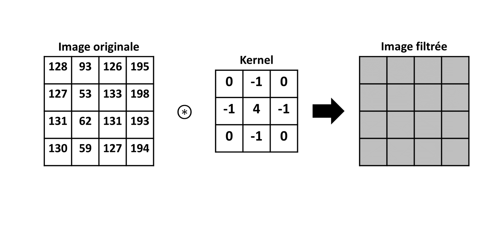

L'avantage de la convolution circulaire est qu'elle permet de conserver la propriété suivante, vis-à-vis de la **Transformée de Fourier Discrète** (TFD) :

$TFD(I \circledast J) = TFD(I) TFD(J)$

|Nota Bene|
|:-|
|On peut aussi choisir d'appliquer la convolution à $I$ sans extansion.|
|Alors, la matrice $S$ aura des **dimensions plus faibles** que $I$, de $-2k$.|
|Ce sera le choix des méthodes d'IA que nous verrons aux chapitres suivants.|

### Choix du kernel

Nous allons voir quelques exemples classiques de kernels $3 \times 3$ en traitement du signal.

Tout d'abord, comme nous l'avions évoqué plus tôt, l'**idendité** pour la convolution est une impulsion de Dirac.
Pour un kernel $3 \times 3$, ceci revient à une convolution circulaire par la matrice :

$\begin{pmatrix}
0 & 0 & 0 \\
0 & 1 & 0 \\
0 & 0 & 0 \\
\end{pmatrix}$

Après application d'une convolution circulaire à une matrice $I$ avec ce kernel, on obtient $S = I$.
L'identité est donc rarement utilisée seule, mais plutôt combinée avec d'autres filtrages linéaires.

Une application typique du filtrage linéaire d'images numériques est le **lissage**.

Il s'agit de **réduire les composantes haute fréquence** horizontales et verticales de l'image.
Ce type de filtrage peut avoir différentes utilités : réduire l'impact du bruit, faire ressortir les grands objets plutôt que les petits détails, anti-aliasing, etc.

Ceci peut être fait par convolution avec un kernel remplaçant chaque pixel de l'image par une **moyenne** des pixels dans le voisinage $3 \times 3$.
Voici les 2 principaux types de moyennes utilisées :

* Le filtre "**box**", qui réalise simplement une moyenne arithmétique des valeurs du pixel et de ses 8 voisins :

$\frac{1}{9} 
\begin{pmatrix}
1 & 1 & 1 \\
1 & 1 & 1 \\
1 & 1 & 1 \\
\end{pmatrix}$

* Le filtre "**gaussien**", qui approxime une pondération gaussienne 2D des valeurs du pixel et de ses 8 voisins :

$\frac{1}{16} 
\begin{pmatrix}
1 & 2 & 1 \\
2 & 4 & 2 \\
1 & 2 & 1 \\
\end{pmatrix}$

Le filtre "box" est plus simple mais moins efficace que le filtre "gaussien" pour lisser une image.

Une autre application typique du filtrage linéaire d'images numériques est la **détection de contours**.

Il s'agit ici de faire ressortir les transitions entre différentes zones de l'image, en utilisant les **dérivées de l'image** par rapport à l'axe horizontal et l'axe vertical.
L'idée est qu'à la frontière entre 2 zones de l'image, la dérivée sera élevée, et elle le sera d'autant plus que le contraste entre les 2 zones est grand.

En $3 \times 3$, une dérivée horizontale peut être approximée par le kernel $\begin{pmatrix} -1 & 0 & 1 \end{pmatrix}$, et une dérivée verticale par le kernel $\begin{pmatrix} -1 \\ 0 \\ 1 \end{pmatrix}$.

Voici les 3 principaux types de dérivations utilisées en pratique :

* Les 2 filtres de **Sobel**, avec le kernel $G_x$ combinant une dérivation horizontale et un lissage vertical, et le kernel $G_y$ combinant une dérivation verticale et un lissage horizontal :

$G_x = 
\begin{pmatrix}
-1 & 0 & 1 \\
-2 & 0 & 2 \\
-1 & 0 & 1 \\
\end{pmatrix}$

$G_y = 
\begin{pmatrix}
-1 & -2 & -1 \\
0 & 0 & 0 \\
1 & 2 & 1 \\
\end{pmatrix}$

$G_x$ permet de faire ressortir les contours **verticaux**, et $G_y$ les contours **horizontaux**.

* Le filtre "**Laplacien à 4 voisins**", et une approximation de l'opérateur Laplacien en 2D (addition de la dérivée seconde horizontale et de la dérivée seconde verticale) avec 4 pixels voisins :

$\begin{pmatrix}
0 & -1 & 0 \\
-1 & 4 & -1 \\
0 & -1 & 0 \\
\end{pmatrix}$

* Le filtre "**Laplacien à 8 voisins**", et également une approximation de l'opérateur Laplacien en 2D, mais avec les 8 pixels voisins :

$\begin{pmatrix}
-1 & -1 & -1 \\
-1 & 8 & -1 \\
-1 & -1 & -1 \\
\end{pmatrix}$

Avec ce type de kernels, nous faisons ressortir les contours, mais nous ne réalisons pas une réellement une "détection" de contours, dans le sens où nous n'extrayons pas les positions des contours.
Nous verrons dans la suite de ce chapitre des méthodes de "détection de contours" à proprement parler.

Enfin, une dernière application typique du filtrage linéaire d'images numériques est l'**amélioration de la netteté**.

Là où le lissage va donner un aspect flou en faisant ressortir les composantes basse fréquence de l'image, un filtre d'amélioration de la netteté va faire **ressortir les composantes haute fréquence**.
Pour ce faire, une technique possible est de **renforcer les contours** dans l'image, en additionnant l'image originale avec l'image obtenue après filtrage pour de la détection de contours.

La convolution étant distributive :

$I + I \circledast
\begin{pmatrix}
0 & -1 & 0 \\
-1 & 4 & -1 \\
0 & -1 & 0 \\
\end{pmatrix}
= I \circledast
\left(\begin{pmatrix}
0 & 0 & 0 \\
0 & 1 & 0 \\
0 & 0 & 0 \\
\end{pmatrix}
+ \begin{pmatrix}
0 & -1 & 0 \\
-1 & 4 & -1 \\
0 & -1 & 0 \\
\end{pmatrix}\right)$

D'où le kernel suivant pour améliorer la netteté d'une image numérique :

$\begin{pmatrix}
0 & -1 & 0 \\
-1 & 5 & -1 \\
0 & -1 & 0 \\
\end{pmatrix}$

Sous Python, avec **Pillow**, on peut appliquer une convolution par un kernel _ker_ à une image _img_ avec _ImageFilter.Kernel_ :

~~~
filt = ImageFilter.Kernel(size=(3,3),kernel=kernel,scale=1)

img_filtered = img.filter(filt)
~~~

La première commande définit le filtre linéaire (avec ses dimensions, son kernel, et optionnellement un facteur d'échelle), la seconde l'applique à l'image.

Cette méthode ne fonctionne que pour des kernels $3 \times 3$ et $5 \times 5$, qui sont les dimensions les plus classiques.
Mais **Pillow** possède aussi de nombreuses implémentations de filtres avec des kernel pré-définis.

**OpenCV** possède une méthode _filter2D_ pour l'application d'un filtre linéaire à partir d'un kernel donné, qui est un peu plus flexible.

Voici quelques exemples d'application de filtre linéaires à notre image d'un _Cynomys ludovicianus_ :

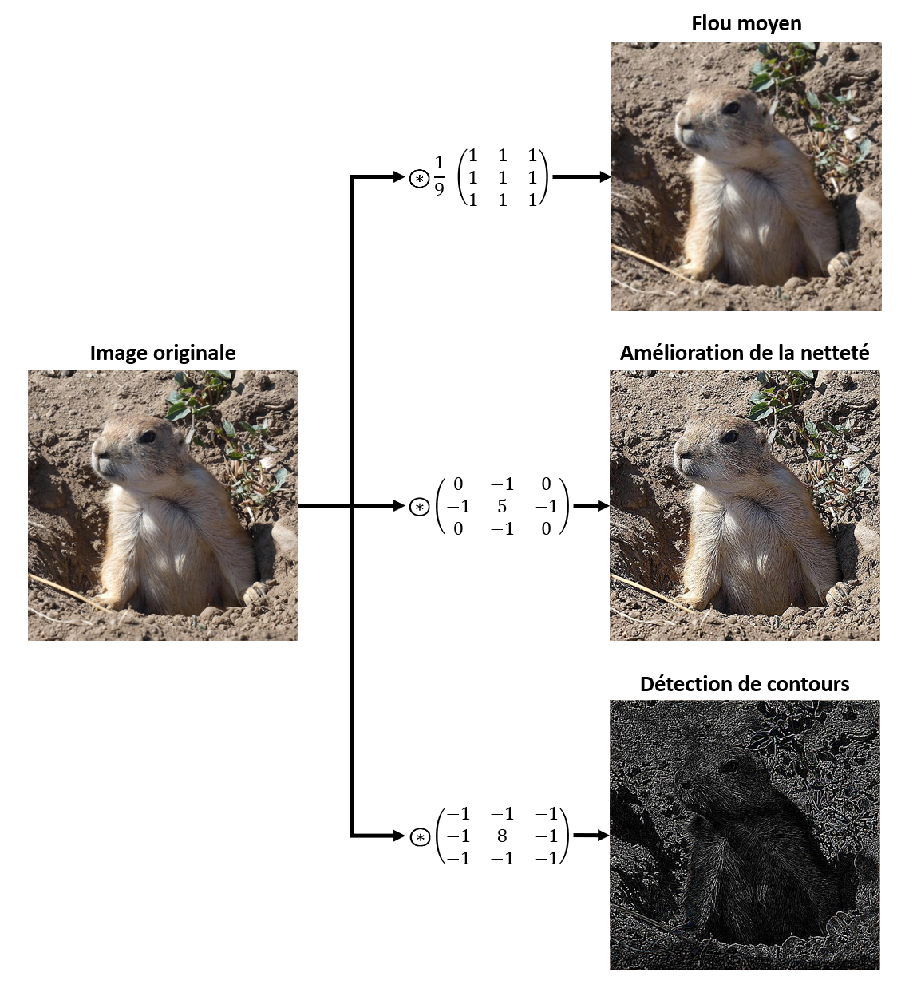

|Nota Bene|
|:-|
|Nous avons vu ici des exemples de kernels $3 \times 3$, mais **plus le kernel choisi est grand, meilleure est l'approximation de la réponse impulsionnelle recherchée**.|
|Aussi, les manipulations géométriques vues précédemment peuvent être en partie définies par des filtrages linéaires, notamment les étapes de **filtrage anti-aliasing** et d'**interpolation**.|

## FFT et filtrage fréquentiel

Comme mentionné plus tôt, on peut considérer une image numérique comme un **signal 2D discret**.
Afin de comprendre la structure d'une image, il peut être intéressant de **discriminer ses différentes composantes fréquentielles horizontales et verticales**.

Les **faibles fréquences** vont caractériser les **grands éléments** de l'image, alors que les **hautes fréquences** vont caractériser les **petits détails**.
La **moyenne** des valeurs de l'image correspondra à composante de **fréquence nulle**.
Et si une image présente une forte périodicité horizontale ou verticale, une analyse fréquentielle permettra de la faire ressortir clairement.

Une fois les composantes fréquentielles de l'image caractérisées, on peut lui appliquer différents **filtres dans le domaine fréquentiel**, afin de faire resortir des élements plus ou moins grands.

Nous allons donc voir comme réaliser l'analyse spectrale d'une image, puis lui appliquer un filtrage en fréquences.

### Analyse spectrale d'une image

En traitement du signal, on utilise la **transformée de Fourier** pour obtenir la représentation d'un signal dans le **domaine fréquentiel**, appelé "**spectre**".
Lorsque l'on dispose d'un signal discret, on utilise la **transformée de Fourier discrète** (TFD) pour approcher de manière discrète le spectre du signal continu correspondant.

Soit une image numérique $I$ de dimensions $M \times N$.
Sa TFD sera une matrice 2D $F£, complexe et de mêmes dimensions, définie comme :

$F[u,v] = \sum_{x=0}^{M-1} \sum_{y=0}^{N-1} I[x,y] \exp(-2 \pi j (\frac{u x}{M} + \frac{v y}{N}))$

Mais la complexité de l'algorithme naïf de la TFD est élevée : $\mathcal{O}(N^2 M^2)$ !
C'est pourquoi on utilise en général l'algorithme de la **FFT** ("Fast Fourier Transform"), qui fait descendre la complexité du calcul de la TFD à $\mathcal{O}(N M (log(M) + log(N)))$.

L'idée est que le calcul naïf de la TFD évalue plusieurs fois les mêmes valeurs, ce que la FFT permet d'éviter.

Le spectre discret $F$ étant complexe, on peut en tirer 2 informations :

* L'**amplitude** à partir du module.
Elle donne l'information sur l'amplitude de chacune des composantes fréquentielles de l'image.
On l'affiche en général en décibels (dB).

* La **phase** à partir de l'argument.
Elle donne l'information du décalage spatial des composantes fréquentielles de l'image.
On l'affiche en général en radians.

Pour afficher le module ou la phase de la FFT d'une image, on utilise en général la représentation "**FFTshift**" :

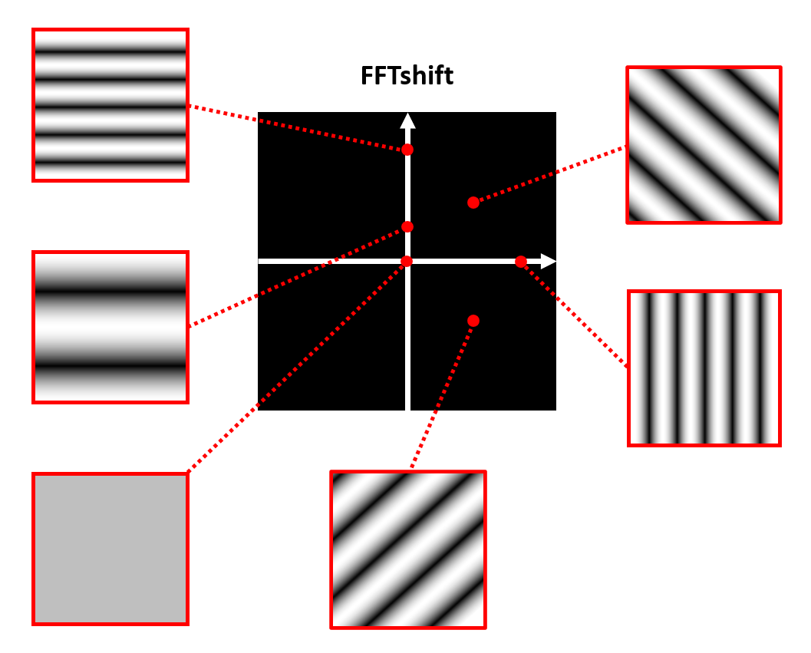

* Cette matrice 2D a les **mêmes dimensions que l'image**.

* La **fréquence nulle** est au **centre** de la matrice, et plus on s'en éloigne et plus la fréquence est élevée.

* Une composante sur l'axe horizontal correspond à une **fréquence horizontale**, une composante sur l'axe vertical correspond à une **fréquence verticale**.

Sous Python, on peut utiliser la méthode **Numpy** _fft.fft2_ qui est une implémentation de la FFT en 2D, puis la méthode **Numpy** _fft.fftshift_ qui permet mettre le résultat en représentation FFTshift.
Voici comment appliquer ces méthodes à une image convertie en Numpy array nommée _img array_, en supposant que l'on ait importé **Numpy** sous le nom _np_ :

~~~
F = np.fft.fft2(img_array)
F_shift = np.fft.fftshift(F)
~~~

Le Numpy array obtenu peut être converti en module puis dB avec :

~~~
F_db = 20*np.log10(np.abs(F_shift)+1e-16)
~~~

Il peut également être converti en phase (radians) avec :

~~~
F_phase = np.angle(F_shift)
~~~

Enfin les axes horizontaux et verticaux de nos représentations peuvent s'obtenir de la manière suivante :

~~~
fx = np.fft.fftshift(np.fft.fftfreq(img_array.shape[1]))
fy = np.fft.fftshift(np.fft.fftfreq(img_array.shape[0]))
~~~

L'unité des axes est le **nombre de cycles par pixel**.

Voici l'application de ces méthodes à notre image d'un _Cynomys ludovicianus_ :

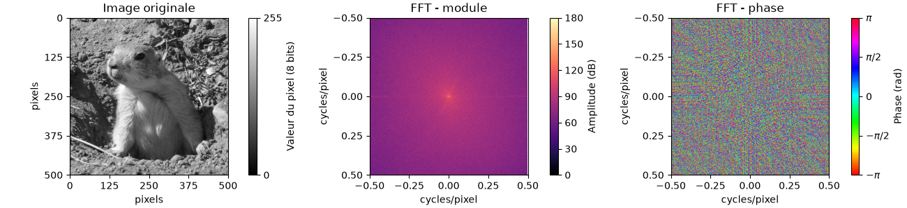

On observe que la fréquence nulle est très intense, ce qui est classique pour une image non-traitée.
En effet, une fréquence de 0 correspond à l'intensité moyenne des pixels de l'image, qui est en général plus intense que ses autres composantes fréquentielles.

On voit aussi des lignes apparaitre que ce soit sur le module ou sur la phase.
Mais correspondent-elles à des vraies composantes fréquentielles de l'image ?

Non, il s'agit d'artefacts appelés "**lobes secondaires**".

Une image numérique n'est jamais infinie, **elle a donc des bords**.
En traitement du signal, ceci revient à multiplier une image infinie par une fenêtre rectangulaire 2D.

|Rappels sur la fenêtre rectangulaire|
|:-|
|En 1D, une **fenêtre rectangulaire** de largeur unitaire est définie comme :|
|$\operatorname{rect}(x)=\begin{cases} 1 & \text{si } \mid x \mid \leq \dfrac{1}{2},\\0 & \text{si } \mid x \mid > \dfrac{1}{2}. \end{cases}$|
|Pour obtenir une fenêtre de largeur $L$, il suffit d'utiliser $rect(x/L)$.|
|Et pour obtenir une fenêtre rectangulaire 2D $\operatorname{rect2D}$ de largeur horizontale $L_x$ et de largeur verticale $L_y$ : $\operatorname{rect2D}(x,y) = \operatorname{rect}(x/L_x) \times \operatorname{rect}(y/L_y)$.|

Or, nous avons vu plus tôt que multiplier 2 signaux dans le domaine "image" revient à une convolution de leurs spectres dans le domaine fréquentiel.
La transformée de Fourier d'une fenêtre rectangulaire étant un sinus cardinal, **multiplier par une fenêtre rectangulaire 2D dans le domaine "image" revient à un convolution par un sinus cardinal 2D dans le domaine fréquentiel** :

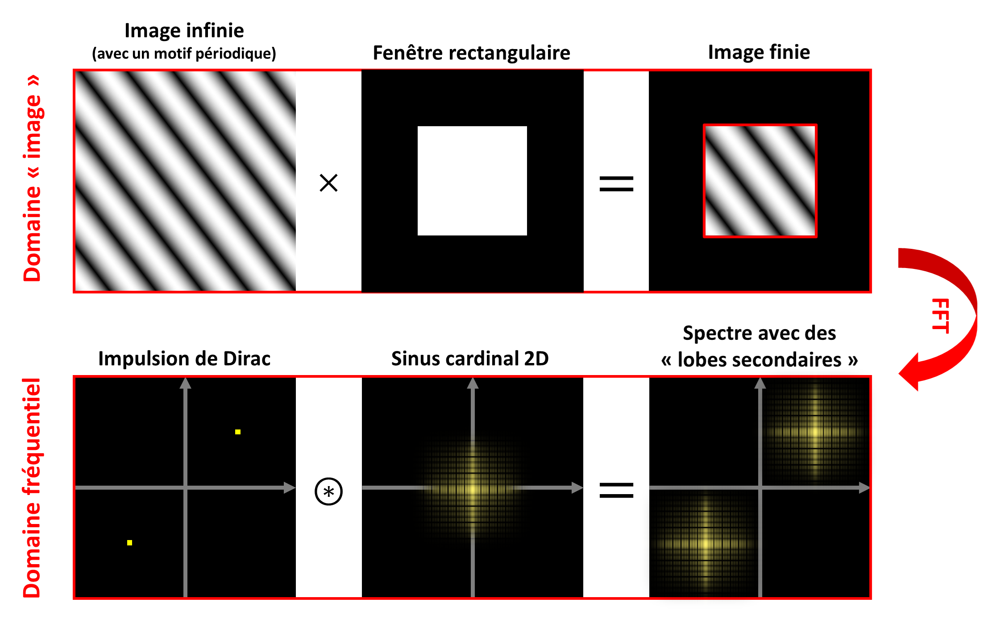

Là où on attendrait une impulsion de Dirac en domaine fréquentiel pour un motif périodique en domaine image, on aura donc un sinus cardinal.
Le lobe principal du sinus cardinal sera bien centré sur la fréquence horizontale/verticale attendue, mais il aura aussi des **lobes secondaires** qui ne correspondent pas à des motifs périodiques existant réellement dans l'image.

Ce sont les sortes de motifs en forme de croix que vous voyez autour du lobe principal sur l'illustration ci-dessus.

|Rappels sur le sinus cardinal|
|:-|
|On définit la fonction **sinus cardinal** normalisée comme :|
|$\operatorname{sinc}(x)=\begin{cases}\dfrac{\sin(\pi x)}{\pi x} & \text{si } x\neq 0,\\1 &\text{si } x=0.\end{cases}$|
|Voici la forme de cette fonction en 1D :|
|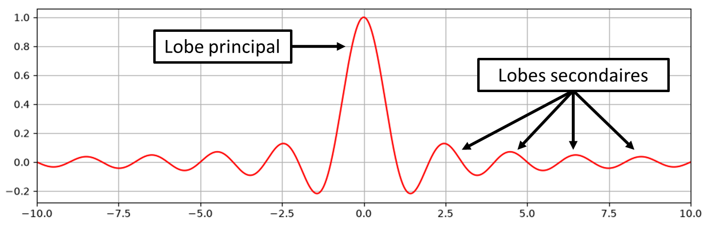|
|En traitement du signal, cette fonction est connue pour être liée au spectre d'une fenêtre rectangulaire :|
|Soit une fenêtre rectangulaire de largeur $L$, sa transformée de Fourier sera $F(x) = L sinc(L x)$.|
|En 2D, la transformée de Fourier d'une fenêtre rectangulaire de largeurs $L_x \times L_y$ est $F(x,y) = L_x L_y sinc(L_x x) sinc(L_y y)$.|

Les "lignes" que nous voyons apparaitre dans le spectre de notre image de _Cynomys ludovicianus_ sont probablement des lobes secondaires du pic central (fréquence 0).
Comment réduire cet artefact pour améliorer la lisibilité du spectre ?

La méthode classique en traitement du signal est l'application d'une **fenêtre d'apodisation** : on multiplie le signal par une fenêtre qui donnera des **lobes secondaires plus faibles** dans le domaine fréquentiel que la fenêtre rectangulaire.

Attention toutefois, cette réduction des lobes secondaires se fait toujours au prix d'un **élargissement du lobe principal**, qui peut aussi rendre le spectre plus difficile à lire.
C'est pourquoi le choix d'une fenêtre d'apodisation est toujours un **compromis**.

Un compromis classique est la **fenêtre de Hann** : $\operatorname{hann}(x)= \begin{cases} \displaystyle \frac{1}{2}\left[1+\cos\left(\frac{2\pi x}{L}\right)\right], & |x|\leq \frac{L}{2}\\ 0, & |x|>\frac{L}{2} \end{cases}$.
En 2D, cette formule devient : $\operatorname{hann}(x) \times \operatorname{hann}(y)$.

Sous Python, on peut définir une fenêtre de Hann 2D de dimensions _lx_ et _ly_ avec **Numpy** de la manière suivante :

~~~
hann_x = np.hanning(lx)
hann_y = np.hanning(ly)

hann_2d = np.outer(hann_y, hann_x)
~~~

On peut ensuite appliquer la fenêtre à une image **avant FFT** :

~~~
img_array = img_array * hann_2d
~~~

Voici l'analyse spectrale de notre image d'un _Cynomys ludovicianus_ avec fenêtrage de Hann :

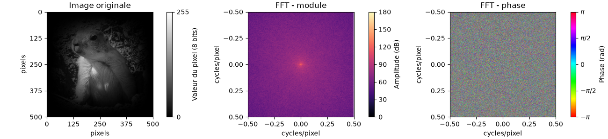

Le module du spectre fait à présent ressortir le pic principal au centre de l'image (qui correspond à la moyenne de l'image), mais il est difficile de distinguer clairement d'autres composantes fréquentielles.
La phase est tout aussi difficile à interpréter.

C'est souvent le cas pour une photographie non-traitée.
Mais il y a des exceptions : si une image présente des motifs périodiques d'amplitude élevée, des composantes fréquentielles claires vont apparaitre dans le spectre.

Par exemple, voyons le spectre de l'image de la Stavkirke de Hopperstad (Norvège) vue a chapitre précédent.
Les tuiles du toit du monument forment des motifs périodiques selon l'axe horizontal et l'axe vertical, ce qui fait clairement apparaitre des composantes dans le spectre :

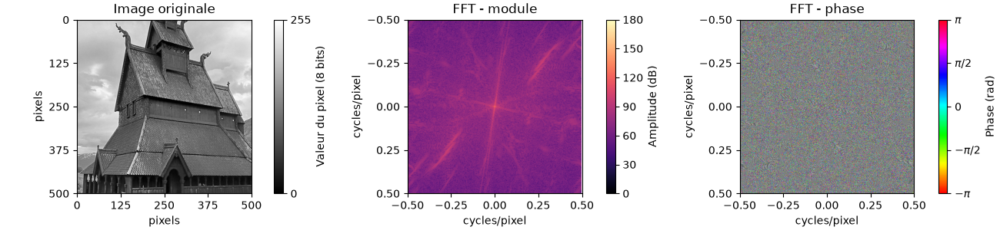

Une image traitée ou retouchée pourra également présenter des composantes identifiables dans son spectre.
C'est d'ailleurs une méthode assez classique de détection de retouches.

Enfin, même si le spectre d'une image est difficilement interprétable par un humain, il peut servir à réaliser des **filtres dans le domaine fréquentiel**.

### Filtrage en fréquences d'une image

Un fois que l'on a obtenu le spectre d'une image numérique, on peut lui appliquer différents **filtrages** pour faire **ressortir certains motifs** de l'image ou en faire **disparaitre d'autres**.

L'idée est toujours la suivante : **appliquer un masque** à la matrice complexe obtenue après FFT afin de diminuer la contribution de certaines composantes fréquentielles, puis lui appliquer une **transformée de Fourier inverse** (IFFT) afin d'obtenir à nouveau une image.

En traitement d'image, on définit souvent un masque grâce à une **fonction gaussienne 2D**, ou une combinaison de plusieurs de ces fonctions.

Voici les 2 types de filtres les plus classiques :

* Le **filtre passe-bas** :

L'idée est de venir couper les hautes fréquences, afin de faire **disparaitre les petits motifs** de l'image.

Pour ce faire, on peut appliquer un masque gaussien $G$ en utilisant la formule suivante :

$G(u,v)=\exp\left(-\frac{(u-u_0)^2+(v-v_0)^2}{2\sigma^2}\right)$

avec $(u_0,v_0)$ les coordonnées de la fréquence zéro sur la matrice 2D du spectre (en convention fftshift), et $sigma$ l'écart-type (en cycles/pixels).
Ce dernier paramètre nous permet de définir la taille du masque : ici plus $sigma$ est grand et moins de fréquences sont filtrées.

Sous Python, pour définir un tel masque adapté à une image _img array_ avec un écart-type de 16 cycles/pixels, on peut utiliser **Numpy** de la manière suivantes :

~~~
h, w = img_array.shape
y, x = np.ogrid[:h,:w]
cy, cx = h//2, w//2

D2 = (x - cx)**2 + (y - cy)**2

sigma = 16

mask = np.exp(-D2/(2*sigma**2))
~~~

Ensuite, pour appliquer ce masque au spectre complexe, puis le re-transformer en image :

~~~
F_filtered = F_shift*mask

img_filtered_array = np.fft.ifft2(np.fft.ifftshift(F_filtered))
img_filtered_array = np.real(img_filtered_array)
~~~

Voici le résultat sur notre image d'un _Cynomys ludovicianus_ :

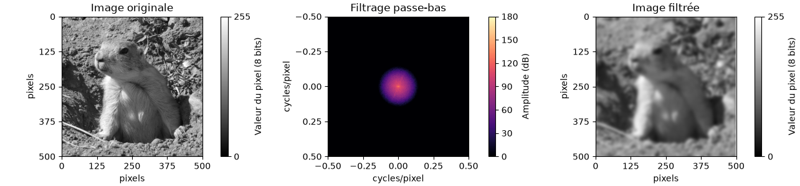

On voit bien ici que l'application d'un filtre passe-bas réduit la contribution des petits motifs.
Il s'agit donc d'un filtre de **lissage**.

|Nota Bene|
|:-|
|Ce résultat était attendu !|
|En effet, nous avons vu qu'appliquer à une image un produit de convolution avec un kernel gaussien permettait de lisser une image.|
|Or, une convolution dans le domaine "image" revenait à un produit dans le domaine fréquentiel, ce qui est exactement ce que nous faisons ici.|
|Par conséquent, les 2 méthodes sont équivalentes.|

* Le **filtre passe-haut** :

L'idée est de venir couper les basses fréquences, afin de faire **disparaitre les grands motifs** de l'image.

Pour se faire, on peut appliquer un masque gaussien en utilisant la formule suivante :

$G(u,v)=1-\exp\left(-\frac{(u-u_0)^2+(v-v_0)^2}{2\sigma^2}\right)$

avec $(u_0,v_0)$ les coordonnées de la fréquence zéro sur la matrice 2D du spectre (en convention fftshift), et $sigma$ l'écart-type (en cycles/pixels).
Ce dernier paramètre nous permet une fois de plus de définir la taille du masque : ici plus $sigma$ est grand et plus de fréquences sont filtrées.

Sous Python, pour définir un tel masque adapté à une image _img array_ avec un écart-type de 16 cycles/pixels, on peut utiliser **Numpy** de la manière suivantes :

~~~
h, w = img_array.shape
y, x = np.ogrid[:h,:w]
cy, cx = h//2, w//2

D2 = (x - cx)**2 + (y - cy)**2

sigma = 16

mask = 1-np.exp(-D2/(2*sigma**2))
~~~

Ensuite, pour appliquer ce masque au spectre complexe, puis le re-transformer en image :

~~~
F_filtered = F_shift*mask

img_filtered_array = np.fft.ifft2(np.fft.ifftshift(F_filtered))
img_filtered_array = np.real(img_filtered_array)
~~~

Voici le résultat sur notre image d'un _Cynomys ludovicianus_ :

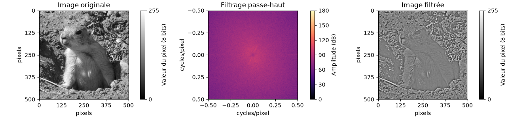

Attention, lorsque nous appliquons un filtre passe-haut à une image, nous faisons disparaitre sa fréquence 0, c'est-à-dire sa moyenne.
Il est donc possible d'obtenir des valeurs de pixels négatives après IFFT, ce qui va contre les conventions d'encodage des images numériques.
C'est pourquoi nous avons ici ajouté 127 à tous les pixels de l'image filtrée (soit la moitié de 255, l'image étant encodée sur 8 bits).

On voit que ce type de filtre fait ressortir les contours (qui sont des variations de cycles/pixel élevées), mais pas uniquement.
Tous les motifs de petite taille ressortent de l'image.
Il ne s'agit donc pas à proprement parler d'un filtre de détection de contours. 

* Pour aller plus loin :

On peut également définir des filtres "**passe-bande**" ou "**coupe-bande**" si on veut faire ressortir ou disparaitre une taille de motif précise de l'image.
On les fabrique en général en combinant 2 fonctions gaussiennes 2D de **sigmas différents**.

## Filtrage non-linéaire

Nous avons vu précédemment des méthodes de filtrage linéaires pour préparer des images à des applications de vision par ordinateur.
Il existe également des **filtrages non-linéaires** très utiles pour améliorer l'interprétabilité d'une image, ou en extraire des informations.

Dans cette section, nous allons aborder le **filtre médian** ainsi que les **opérations morphologiques**, qui sont les 2 types de filtrages non-linéaires les plus classiques en traitement d'image.

### Filtre médian

Lorsque certains photosites d'un capteur photographique sont défectueux, ou lorsque l'encodage / l'enregistrement / la transmission d'une image manque des pixels, il arrive qu'une image numérique souffre de ce que l'on appelle un **bruit poivre et sel**.

On appelle "bruit poivre et sel" l'apparition aléatoire de pixels noirs et blancs (les 3 primaires à 0 ou les 3 primaires à 255 pour 8 bits) sur une image numérique.
D'où son nom.

La méthode classique pour réduire l'impact d'un tel bruit est le **filtrage médian**.

Il s'agit d'un filtre non-linéaire, qui s'applique de la manière suivante : 

* On fait passer une fenêtre glissante carrée de dimension impaire (en général 3, 5 ou 7) sur l'image.

* Chaque pixel est remplacé par la médiane des valeurs des pixels de la fenêtre centrée sur lui.

* Les effets de bords peuvent être réglés de la même façon que pour la convolution (complétion par des zéros, répétition, symétrie, circulaire).

Voici une illustration du fonctionnement du filtre médian $3 \times 3$ avec gestion des bords circulaire :

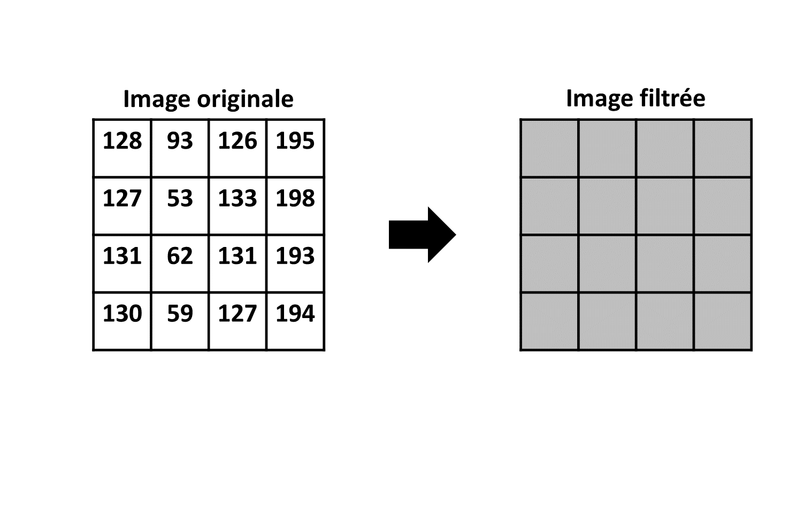

Sous Python, il existe une implémentation **Open-CV** du filtre médian, sous la forme d'une méthode _medianBlur_, que l'on peut appliquer à une image _img_ préalablement importée avec la même bibliothèque.
Voici la commande pour une fenêtre de dimensions $3 \times 3$ :

~~~
img_filtered = cv.medianBlur(img,3)
~~~

Il est possible d'indiquer la convention de gestion des bords désirée dans les paramètres d'entrée de la méthode.

Voici un exemple d'application de ce filtrage médian à notre image d'un _Cynomys ludovicianus_, à laquelle nous avons ajouté artificiellement un "bruit poivre et sel" :

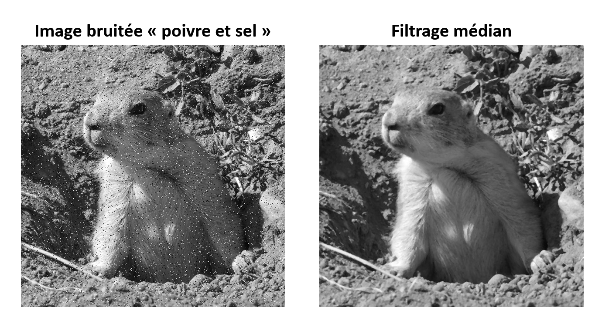

On voit que le filtre médian a efficacement réduit le "bruit poivre et sel", mais au pris d'un **lissage non désiré** de l'image.
Si la **réduction du bruit** est d'autant plus forte que **la fenêtre est grande**, le **lissage** sera aussi d'autant plus fort.
C'est pourquoi on limite en général la taille de la fenêtre à 7 pixels grand maximum.

### Opérations morphologiques

Le second type de filtrage non-linéaire que nous allons traiter sont les **opérateurs morphologiques**.
Il s'agit d'une application aux images numériques de la théorie de la morphologie en mathématiques.

Pour chacune de ces méthodes, nous commencerons par donner leur définition dans le cas simple d'une image numérique **binaire** (ne contenant que 2 valeurs possibles 0 ou 1), puis nous les généraliserons à une image en **niveaux de gris**.

Partons du principe que la position $(x,y)$ de chaque pixel appartient à $\mathbb{Z}^2$.
Une image numérique **binaire** $I_b$ peut être vue comme **l'ensemble des positions des pixels ayant la valeur 1**, en considérant alors 0 comme une valeur par défaut.
Donc $I_b^$ peut être vue comme **un sous-ensemble de $\mathbb{Z}^2$**, soit : $I_b \subset \mathbb{Z}^2$.

On appelle cette manière de modéliser mathématiquement une image numérique binaire "**l'approche ensembliste**".

Le principe des opérations morphologiques est de définir un autre sous-ensemble $E \subset \mathbb{Z}^2$ appelé "**élément structurant**", qui va servir de masque que l'on va déplacer sur l'image pour modifier les valeurs des pixels en fonction de leur voisinage.
Les filtres que nous allons voir dans la suite sont donc toujours définis comme une opération de $I_b$ par $E$.

Les éléments structurants classiques en traitement d'images sont les suivants :

* Le **carré** :

* La **croix** :

* Le **disque** :

Pour généraliser les opération morphologiques à des images en **niveaux de gris**,  

### Erosion et dilatation

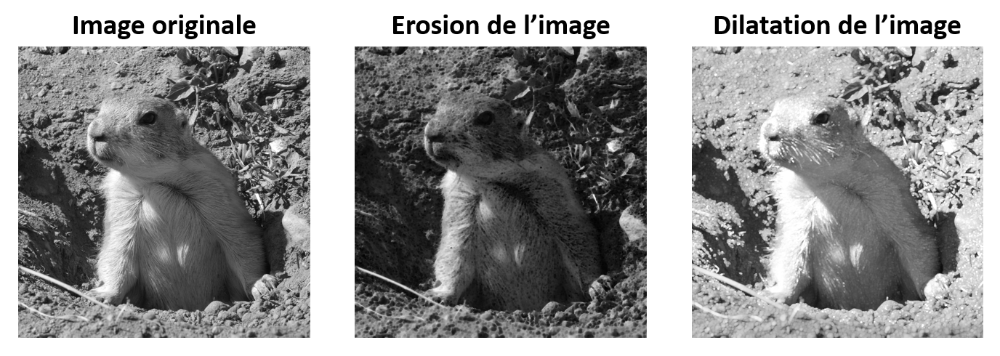

### Ouverture et fermeture

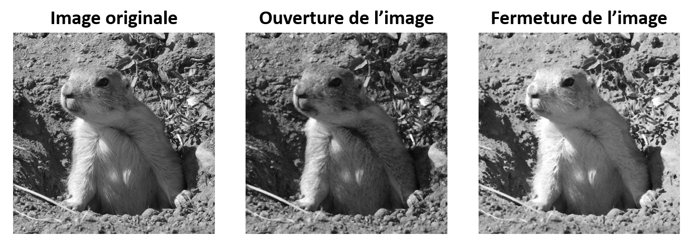

## Détection de contours ou de coins

### Filtre de Sobel

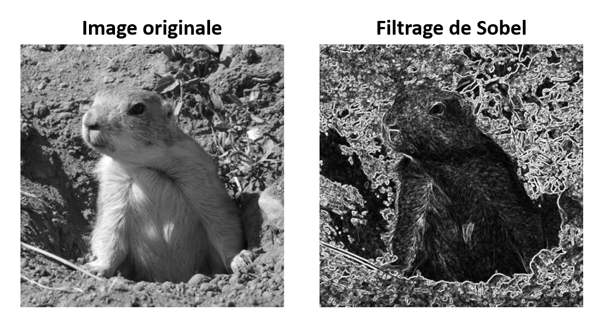

### Filtre de Canny

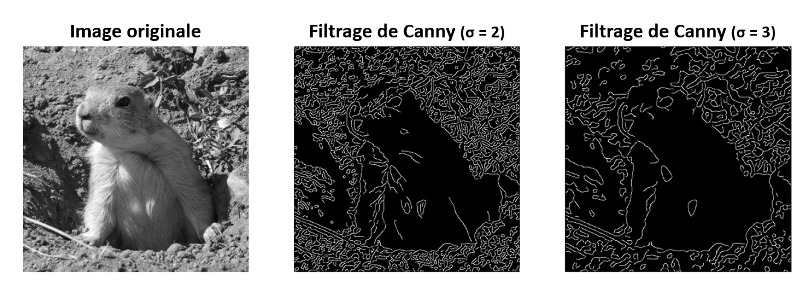

### Filtre de Harris

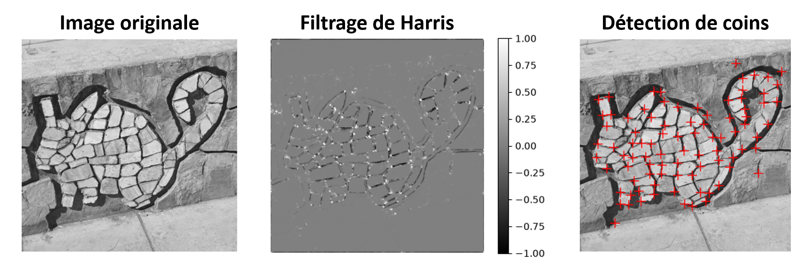

## Détection de forme

### La transformée de Hough

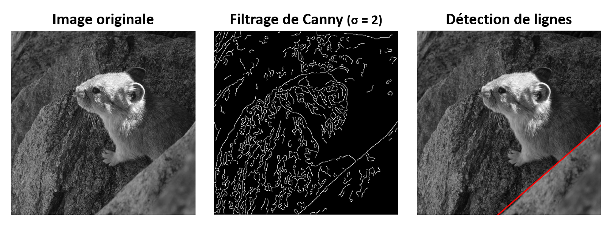

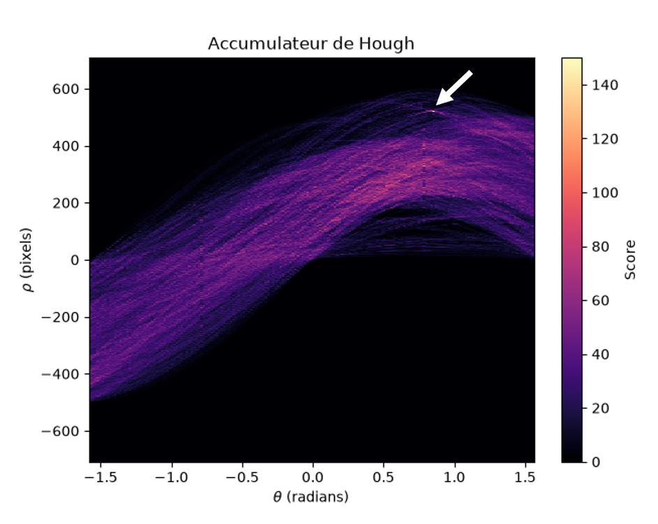

### Adaptation aux cercles

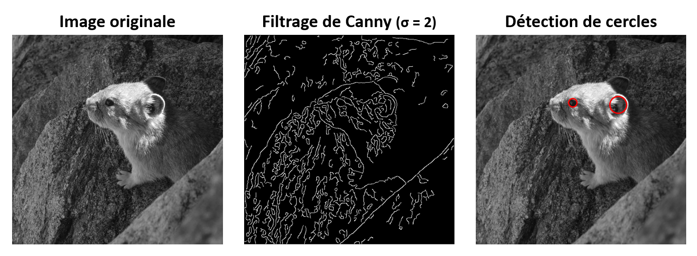

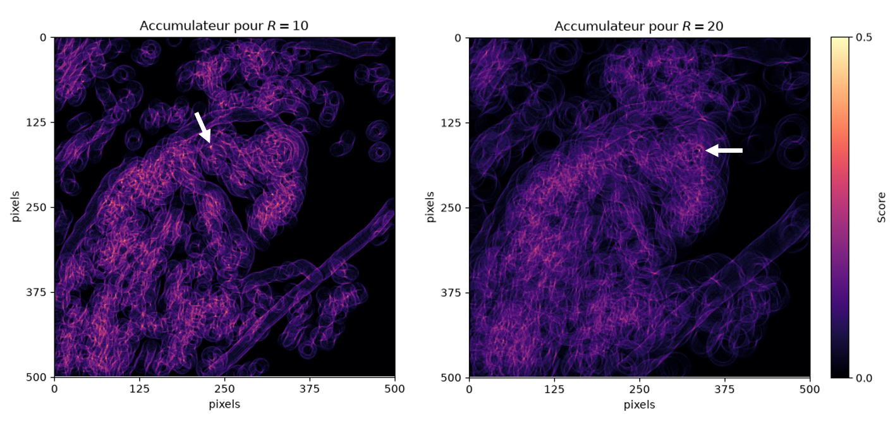

### Généralisation