# Chapitre II : Le traitement d'images, l'art du filtrage et de la transformation

Ce chapitre abordera les fondamentaux du traitement d'images numériques.
Il introduira entre autres les filtres et transformées qui sont à la base des outils "d'apprentissage profond" (ou "Deep Learning" en anglais) utilisés en "vision par ordinateur".

_"Vibre la lumière, Chantez les couleurs, Il y met sa vie, Le bruit de son coeur._

_Et comme un bateau, Porté par sa voile, Doucement le pinceau, Glisse sur la toile._

_Et voilà l'homme, Qui croise avec ses yeux, Le temps d'un éclair, Le regard des dieux._

_Cézanne peint, Il laisse s'accomplir le prodige de ses mains._

_Cézanne peint, Et il éclaire le monde pour nos yeux qui n'voient rien."_

**Michel Berger & France Gall, Cézanne peint, 1985**

---

## Images exemples

Ce chapitre sera illustré par quelques images exemples.

Vous trouverez la première [ici](https://github.com/NicOudart/UVSQ_EN3901_computer_vision/blob/master/images/Prairie_dog.jpg).

Il s'agit d'une photographie d'un _Cynomys ludovicianus_, aussi connu sous le nom de "Black-tailed Prairie Dog", prise en 2022 à Boulder (Colorado, USA).

Par défaut, nous utiliserons cette image pour illustrer les différentes méthodes de traitement d'images.

Dans les cas spécifiques où nous avons besoin d'une image contenant des contours ou des coins bien définis, nous utiliserons une seconde image que vous trouverez [ici](https://github.com/NicOudart/UVSQ_EN3901_computer_vision/blob/master/images/Vizcacha.jpg).

Il s'agit d'une photographie d'une mosaïque représentant une _Lagidium peruanum_, aussi connue sous le nom de "Vizcacha del Norte", prise en 2025 à Huancayo (Pérou).

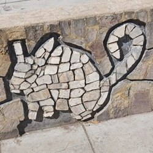

Et dans les cas spécifiques où nous avons besoin d'une image avec des lignes ou des cercles à détecter, nous utiliserons une troisième image que vous trouverez [ici](https://github.com/NicOudart/UVSQ_EN3901_computer_vision/blob/master/images/Pika.jpg).

Il s'agit d'une photographie d'un _Ochotona princeps_, aussi connu sous le nom d' "American Pika", prise en 2022 au Rocky Mountain National Park (Colorado, USA).

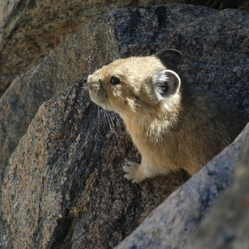

N'hésitez pas à aller regarder les détails de la prise de vue des différentes photographies dans les métadonnées des images !

## Le traitement d'image

## Transformations géométriques

### Agrandissement / réduction

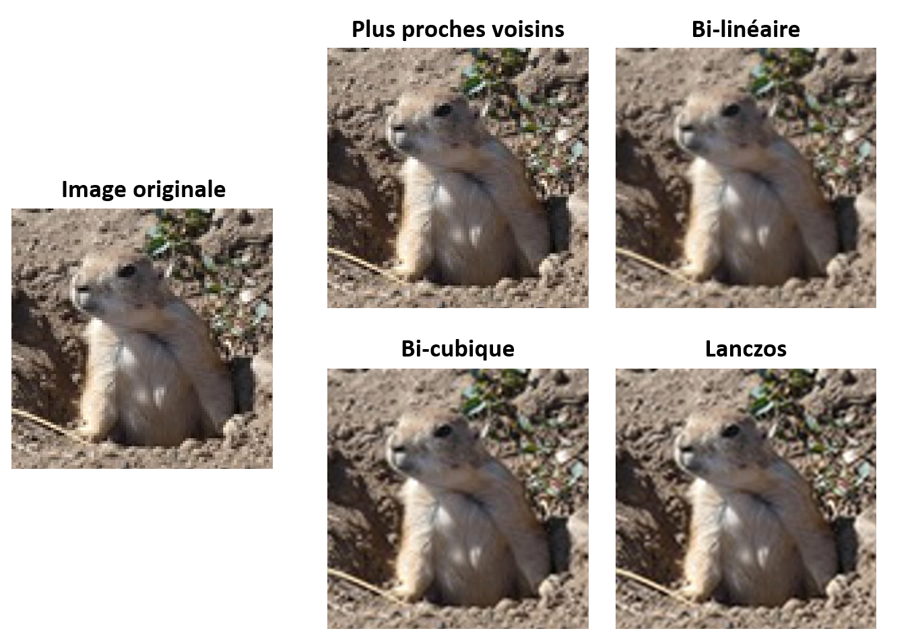

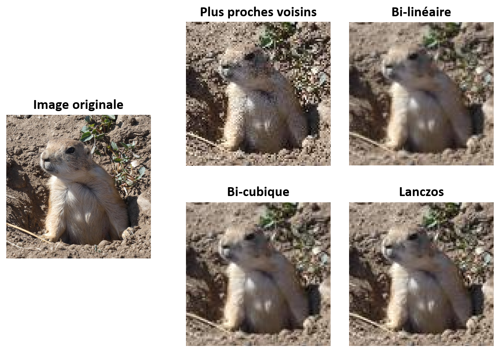

### Rotation / translation

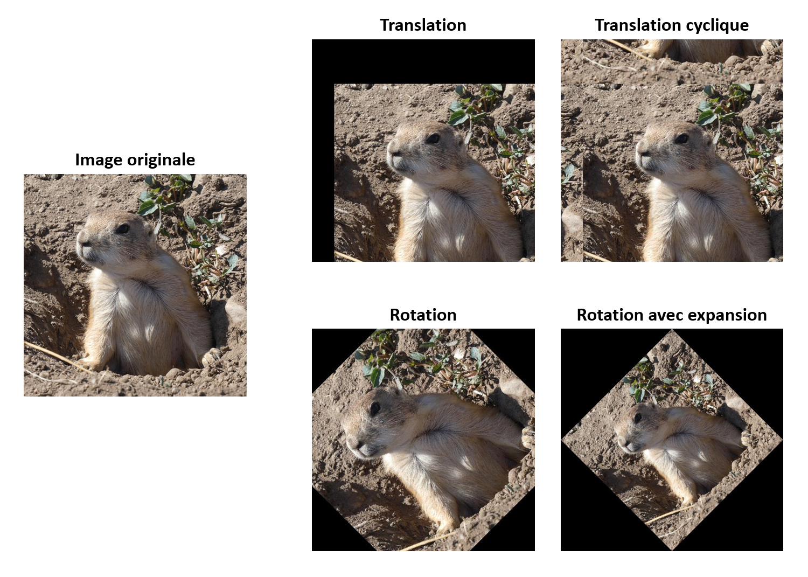

## Filtrage linéaire

### Convolution

### Choix du kernel

## FFT et filtrage fréquentiel

### Analyse spectrale d'une image

### Filtrage en fréquences d'une image

## Opérations morphologiques

### Element structurant

### Filtre médian

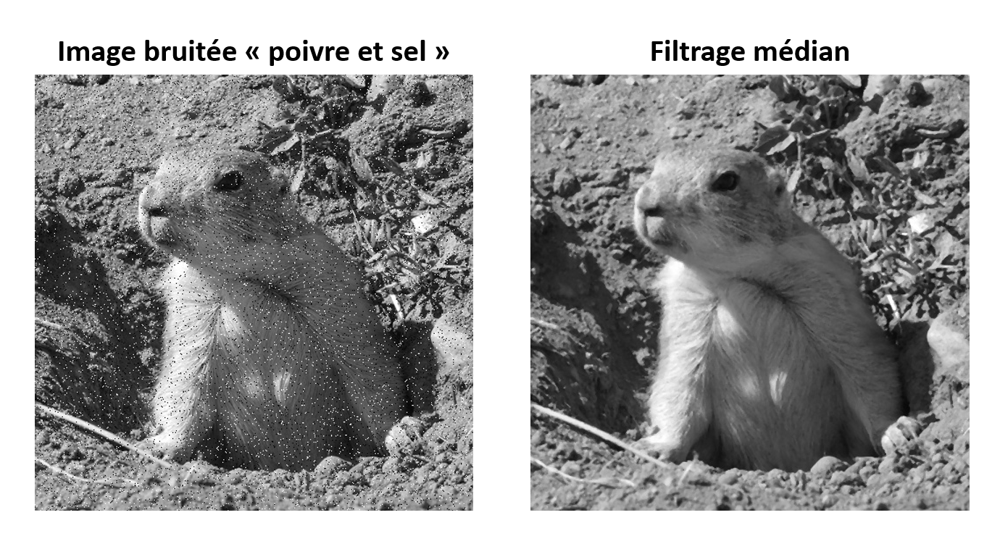

### Erosion et dilatation

### Ouverture et fermeture

## Détection de contours ou de coins

### Filtre de Sobel

### Filtre de Canny

### Filtre de Harris

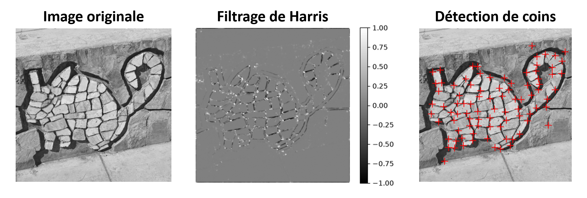

## Détection de forme

### La transformée de Hough

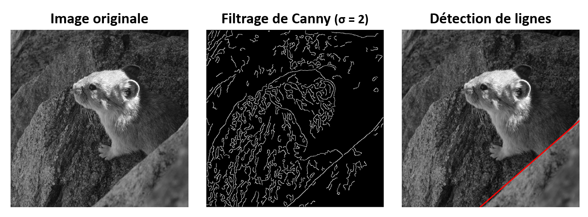

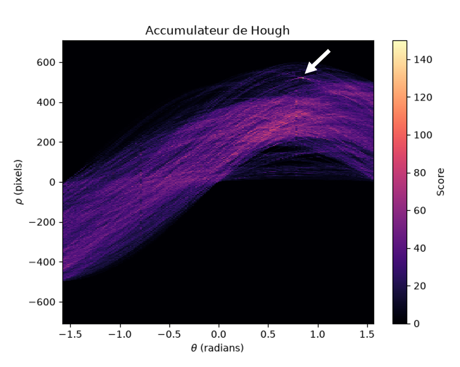

### Adaptation aux cercles

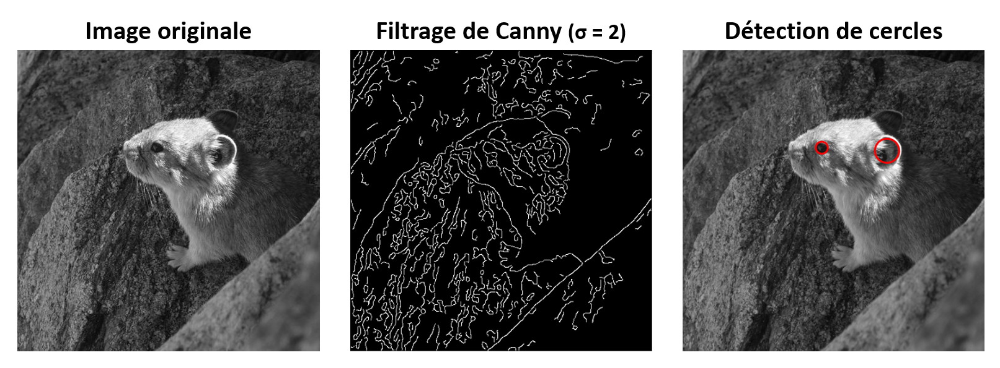

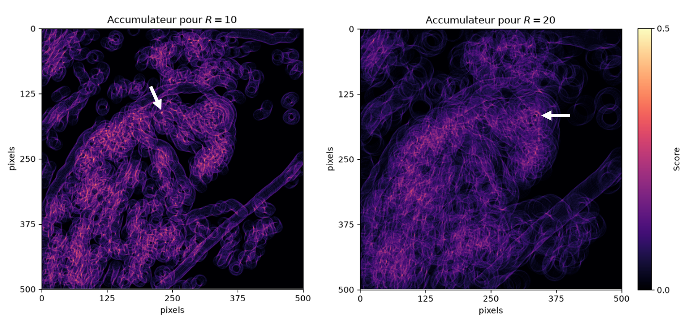

### Généralisation